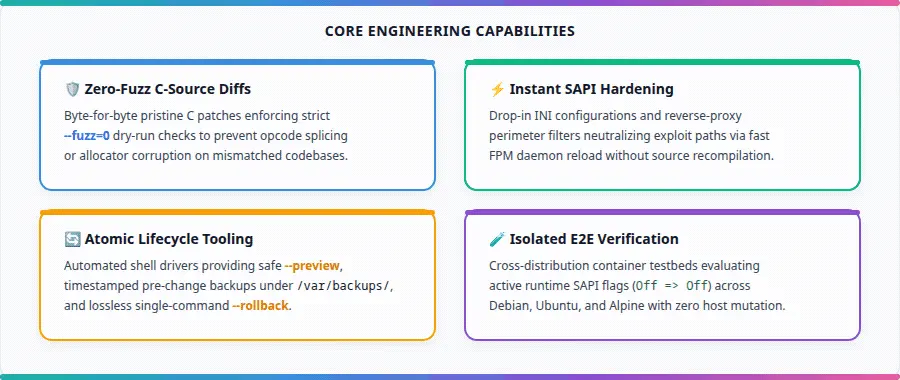
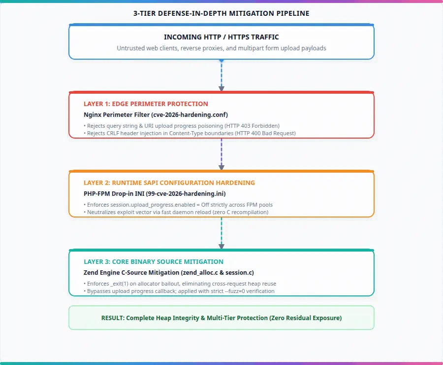

<p align="center">
  
</p>

<h1 align="center">PHP Core CVE Patch Collection</h1>

<p align="center">
  <strong>Curated source-level security mitigations, zero-fuzz C patches, runtime SAPI hardening drop-ins, and multi-distro regression suites for legacy PHP runtimes (PHP 5.5 through PHP 8.1 EOL).</strong>
</p>

<p align="center">
  <a href="https://saweria.co/andycungkrinx"></a>
  <a href="https://www.linkedin.com/in/andy-setiyawan-452396170/"></a>
  <a href="https://github.com/andycungkrinx91/konoha"></a>
  <a href="LICENSE"></a>
</p>

<p align="center">
  
  
  
  
  
</p>

---

## ☕ Support & Buy Me a Coffee

If this collection helps protect your infrastructure or saves your engineering team hours of emergency backporting, consider buying me a coffee to support continued development and maintenance:

<p align="center">
  <a href="https://saweria.co/andycungkrinx">
    
  </a>
</p>

---

<p align="center">
  <a href="#overview">Overview</a> •
  <a href="#cve-mitigation-catalog">CVE Catalog</a> •
  <a href="#layered-defense-architecture">Architecture</a> •
  <a href="#quick-start">Quick Start</a> •
  <a href="#empirical-verification-test-matrix">Testing</a> •
  <a href="#adding-a-new-cve-suite">Contributing</a> •
  <a href="#author">Author</a> •
  <a href="#license">License</a>
</p>

---

## Overview

When critical vulnerabilities affect end-of-life (EOL) PHP runtimes, upstream maintenance ceases and no official security patches are released by the PHP Group. Enterprise workloads, legacy applications, and operational constraints often prevent immediate upgrades to supported branches (PHP 8.2+ or 8.3+), leaving core Zend Engine allocators and request handlers exposed to remote compromise.

This repository provides **battle-tested, production-ready security mitigations** specifically engineered for legacy PHP environments.

> [!NOTE]
> **Engineering Provenance**:  
> I built this collection using agentic coding workflows, the **[Konoha Workflow](https://github.com/andycungkrinx91/konoha)**, and practical domain knowledge in low-level Linux systems security. Operational guardrails are strictly observed: zero host mutation, fail-closed zero-fuzz patch gates, and reproducible container regression validation.

---

### Core Engineering Capabilities

<p align="center">
  
</p>

| Pillar | Mechanism | Operational Benefit |
|---|---|---|
| **Zero-Fuzz C Diffs** | Byte-for-byte pristine source patches enforcing `--fuzz=0` dry-run verification | Eliminates risk of opcode splicing or allocator corruption on mismatched trees |
| **Instant SAPI Hardening** | Drop-in INI configurations and reverse-proxy perimeter filters | Neutralizes exploit vectors immediately via daemon reload without C recompilation |
| **Reversible Tooling** | Automated shell drivers with `--preview`, pre-change backups, and atomic `--rollback` | Allows safe evaluation and instant restoration without leaving leftover artifacts |
| **Cross-OS Verification** | Containerized regression harnesses testing Debian, Ubuntu, and Alpine | Validates runtime FPM SAPI flags (`Off => Off`) across diverse Linux families |

---

## CVE Mitigation Catalog

Each security mitigation suite is maintained in an isolated directory (`cve-<id>/`):

| Directory | Target Vulnerabilities | Severity | Target PHP Versions | Remediation Layers | Documentation |
|---|---|:---:|---|---|:---:|
| [`cve-2026-109618-109619/`](cve-2026-109618-109619/) | **CVE-2026-109618**<br>**CVE-2026-109619**<br>*(PHP2Shell)* | **Critical**<br>`CVSS 9.8` | PHP 5.5, 5.6, 7.0, 7.1, 7.2, 7.3, 7.4, 8.0, 8.1 | • Zero-fuzz C source patches (5.5–8.1)<br>• FPM runtime INI drop-in (`upload_progress = Off`)<br>• Nginx edge perimeter filter<br>• Universal autopatch script (`universal-autopatch-*.sh`)<br>• Dynamic C compiler (`compile-and-patch-vm-cve.sh`)<br>• Multi-stage Docker builders (glibc & musl) | [**Guide**](cve-2026-109618-109619/README.md) |

### Components in `cve-2026-109618-109619/`

- **Clean Source Patches**: `php5.5-cve-109618-109619.patch` through `php8.1-cve-109618-109619.patch`. Neutralizes bailout memory corruption in `Zend/zend_alloc.c` and RFC1867 upload progress poisoning in `ext/session/session.c`.
- **Universal Autopatch CLI**: `universal-autopatch-109618-109619.sh` provides autodetection, configuration drop-in injection, service signaling, and rollback across Ubuntu, Debian, CentOS/RHEL/AlmaLinux, and Alpine Linux.
- **Dynamic C-Source Rebuilder**: `compile-and-patch-vm-cve.sh` automates on-demand source retrieval, ABI header resolution, C compilation, and atomic binary swapping for Linux VMs.
- **Edge Perimeter Filter**: `cve-2026-hardening.conf` strips malicious upload progress directives at the Nginx reverse-proxy tier before reaching FastCGI sockets.
- **Cross-OS E2E Harness**: `test-cross-os-e2e.sh` validates preview, application, SAPI flags, and rollback in disposable containers.
- **Container Recipes**: `docker-image/` houses multi-stage Ubuntu 24.04 (`Dockerfile.sample`) and Alpine musl (`Dockerfile.alpine`) build environments.
- **Architecture Schematics**: `docs/images/` contains vector and webp pipeline diagrams.

---

### Threat Model & Vulnerability Mechanics

The mitigations address two coupled vulnerabilities:
- **Zend Bailout Corruption (CVE-2026-109618)**: When request processing exhausts configured memory limits during multipart upload parsing, the Zend engine executes an ungraceful bailout via `longjmp()`. Internal allocator metadata remains uncleared. This allows heap grooming and code execution across persistent FastCGI worker processes.
- **Upload Progress Header Poisoning (CVE-2026-109619)**: Attackers send an unauthenticated `PHP_SESSION_UPLOAD_PROGRESS` header to force session initialization before standard authentication runs. This drops arbitrary serialized payloads into temporary session files on disk.

---

## Layered Defense Architecture

The collection enforces a multi-tier defense-in-depth model so teams can deploy immediate edge and runtime protections while scheduling off-host binary rebuilds:

<p align="center">
  
</p>
<p align="center">
  <em>Figure 1: Tokubetsu-Jonin Animated Defense-in-Depth Mitigation Pipeline (Vector source: <a href="docs/images/defense-in-depth-architecture.svg">docs/images/defense-in-depth-architecture.svg</a>)</em>
</p>

---

## Quick Start

All tools are located inside their respective CVE directories. To evaluate and deploy protections for CVE-2026-109618 / 109619:

### 1. Safe Inspection (Zero File Changes)

Run the universal autopatcher in preview mode to inspect your system, identify active PHP SAPIs, and check patch compatibility:

```bash
cd cve-2026-109618-109619
./universal-autopatch-109618-109619.sh --preview
```

### 2. Apply Runtime Configuration Hardening

Deploy the FPM drop-in configuration and reload the PHP-FPM daemon. A timestamped pre-change backup is created automatically under `/var/backups/php-cve-mitigation/`:

```bash
sudo ./universal-autopatch-109618-109619.sh --apply
```

### 3. Revert Changes (Lossless Rollback)

To cleanly restore original configuration files and remove mitigation drop-ins:

```bash
sudo ./universal-autopatch-109618-109619.sh --rollback
```

### 4. Rebuild Binary from Source (Optional / Host C Rebuild)

To dynamically download matching pristine source code, apply zero-fuzz patches, and compile patched `php-fpm` and `php` CLI binaries:

```bash
sudo ./compile-and-patch-vm-cve.sh
```

---

## Empirical Verification & Test Matrix

Regression tests execute inside ephemeral, unprivileged Docker sandboxes to guarantee host operating systems remain completely unaltered baselines.

```bash
cd cve-2026-109618-109619
./test-cross-os-e2e.sh all
```

### Empirical Results

| Test Target | Container Environment | PHP Version | SAPI Evaluated | Status | Verification Details |
|---|---|:---:|:---:|:---:|---|
| **`debian9`** | Debian 9.13 Stretch | PHP 7.0.33 | FPM Runtime | `PASS` | Preview, drop-in injection, live SAPI `Off`, and rollback verified |
| **`ubuntu18`** | Ubuntu 18.04 LTS Bionic | PHP 7.2.24 | FPM Runtime | `PASS` | Preview, drop-in injection, live SAPI `Off`, and rollback verified |
| **`debian12`** | Debian 12 Bookworm | PHP 8.1 target | FPM Runtime | `PASS` | Target drop-in generation, file verification, and rollback verified |
| **`alpine`** | Alpine Linux 3.21 | PHP 8.1 target | FPM Runtime | `PASS` | Musl libc drop-in generation, syntax test, and rollback verified |

### Tooling Coverage vs. Empirical Verification

- **Platform Badges & Autodetection**: The platform badges above represent the OS detection and path-routing capability implemented in `universal-autopatch-109618-109619.sh` (Ubuntu 14.04–24.04, Debian 7–13, EL 6–9, Alpine 3.16+).
- **Automated Container Evidence**: Automated E2E verification is actively executed in isolated Docker containers for the four primary targets (`debian9`, `ubuntu18`, `debian12`, `alpine3.21`), where 4 of 4 suites pass cleanly with zero failures.
- **Nginx Edge Filter**: `cve-2026-hardening.conf` returns HTTP 403 on requests matching `PHP_SESSION_UPLOAD_PROGRESS` and HTTP 400 on header line breaks (`[\r\n]`) in `Content-Type`.
- **Runtime SAPI Hardening**: Applying configuration drop-ins signals PHP-FPM via daemon reload/restart without requiring a C compiler. In testing, `php-fpm -i` confirms that `session.upload_progress.enabled` is enforced to `Off`.

---

## Adding a New CVE Suite

Contributors and maintainers adding a new vulnerability suite must follow this standard layout:

```text
php-patch-collection/
├── README.md                                  # Catalog table and matrix index
└── cve-YYYY-NNNNN/                            # New isolated CVE directory
    ├── README.md                              # Comprehensive operator and technical guide
    ├── LICENSE                                # MIT License
    ├── php<ver>-cve-YYYY-NNNNN.patch          # Versioned zero-fuzz C patches
    ├── universal-autopatch-YYYY-NNNNN.sh      # Self-contained preview/apply/rollback CLI
    ├── test-cross-os-e2e.sh                   # Isolated container regression harness
    ├── cve-YYYY-hardening.conf                # Reverse-proxy perimeter filter
    └── docker-image/                          # Multi-stage container recipes
```

### Contribution Invariants

1. **Self-Contained Directory**: Scaffold `cve-<canonical-id>/` under the repository root. Never share global mutable state across distinct CVEs.
2. **Zero-Fuzz Integrity**: All C-source patches must apply cleanly with `patch -p1 --fuzz=0`. Hardcode SHA-256 checksums in automation scripts.
3. **Reversible Operations**: All scripts must provide `--preview`, `--apply`, and `--rollback` modes with automatic backups to `/var/backups/`.
4. **Isolated E2E Tests**: Provide a containerized regression suite testing supported distributions. Every test run must report zero failures.
5. **Accurate Demarcation**: Keep platform claims strictly evidence-based. If a distribution was not executed in a test container, mark it as unverified.

---

## Author

**Andy Setiyawan**
- **LinkedIn**: [andy-setiyawan-452396170](https://www.linkedin.com/in/andy-setiyawan-452396170/)
- **Repository**: [https://github.com/andycungkrinx91/php-patch-collection](https://github.com/andycungkrinx91/php-patch-collection)
- **Built with**: [Konoha Workflow](https://github.com/andycungkrinx91/konoha)
- **Support**: [Buy Me a Coffee (Saweria)](https://saweria.co/andycungkrinx)

---

## License

This project is licensed under the [MIT License](LICENSE).
