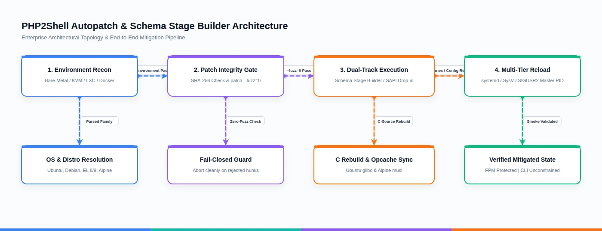
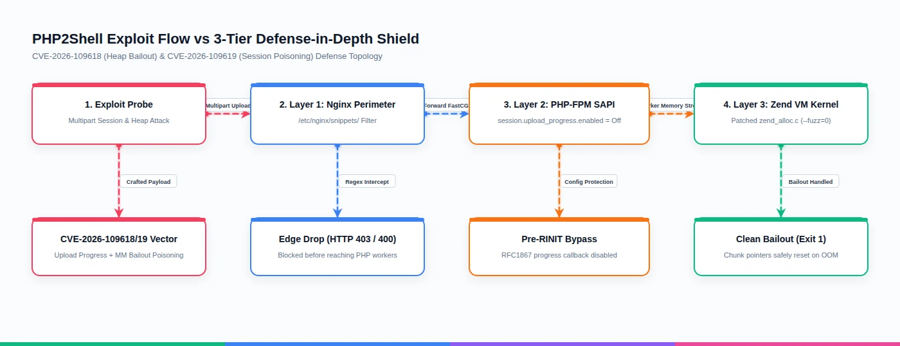
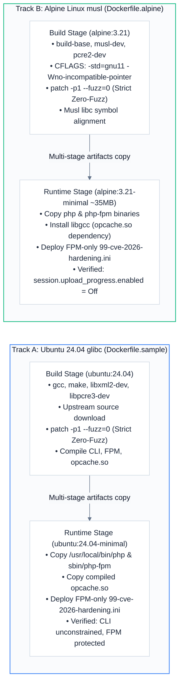

# CVE-2026-109618 / CVE-2026-109619

<p align="center">
  <a href="https://saweria.co/andycungkrinx"></a>
  <a href="https://www.linkedin.com/in/andy-setiyawan-452396170/"></a>
  <a href="https://github.com/andycungkrinx91/konoha"></a>
  <a href="LICENSE"></a>
</p>

<p align="center">
  
  
  
  
  
</p>

<p align="center">
  
  
  
  
  
</p>

---

## ☕ Support & Buy Me a Coffee

If this collection helps protect your infrastructure or saves your engineering team hours of emergency backporting, consider buying me a coffee to support continued development and maintenance:

<p align="center">
  <a href="https://saweria.co/andycungkrinx">
    
  </a>
</p>

---

<p align="center">
  <a href="#operational-scope-architecture-overview">Scope Overview</a> •
  <a href="#1-deliverables-overview">Deliverables</a> •
  <a href="#4-quick-start-virtual-machine-lxc-container-autopatch">Quick Start</a> •
  <a href="#5-nginx-perimeter-hardening-guide">Nginx Filter</a> •
  <a href="#6-php-fpm-configuration-specification">FPM Drop-in</a> •
  <a href="#7-docker-container-build-guide-schema-stage-builder">Docker Builds</a> •
  <a href="#8-verification-smoke-testing">Verification</a> •
  <a href="#9-version-coverage-matrix-e2e-evidence-technical-disclosures">Matrix & Limits</a>
</p>

---

**Date**: 2026-10-22  
**Target Scope**: PHP 5.5 through PHP 8.1 (End-of-Life Scope)  

### Operational Scope & Architecture Overview

| Domain / Component | Target Scope | Implementation Mechanism | Tooling Scope vs. Verified Test Evidence |
|---|:---:|---|---|
| **Tier 1: Upstream Patches** | **PHP 7.4, 8.0, 8.1** | Full C-source rebuild (`--build-binary`) via upstream vendor diffs | **Verified Natively**: In-place rebuild verified in native LXC (`php74-mitigation` on Ubuntu 20.04, `php80-mitigation` on 22.04, `php81-mitigation` on 22.04, and `centos9-test-lxc` on CentOS Stream 9). |
| **Tier 2: Community Backports** | **PHP 7.0, 7.1, 7.2, 7.3** | Zero-fuzz C-source rebuild (`--fuzz=0`) for early Zend Engine 3 | **Verified in Native LXC**: In-place rebuild verified in native LXC across all ZE3 branches (`php-legacy-lxc` 7.0, `php71-test-lxc` 7.1, `bionic-test-lxc` 7.2, `php73-test-lxc` 7.3). Automated runner: `test-cross-os-e2e.sh debian9`, `ubuntu18`. |
| **Tier 3: Legacy Engine Hardening** | **PHP 5.5, 5.6** | Zend Engine 2 (ZE2) C-source range rebuild + FPM configuration hardening | **Verified in Native LXC**: Zero-fuzz range patch rebuild and transition verified in `php-trusty-lxc` (Ubuntu 14.04 / PHP 5.5.9) and `php56-test-lxc` (Ubuntu 18.04 / PHP 5.6.40). |
| **Configuration Hardening** | **PHP 5.5 – 8.1** | Runtime FPM SAPI drop-in (`99-cve-2026-hardening.ini`) & Nginx rule | **Universal Tooling Scope**: Generates drop-in and signals daemon across Debian, Ubuntu, CentOS, and Alpine. Verified at runtime (`Off => Off`) on tested testbeds. |
| **Universal Autopatch**<br>`universal-autopatch-109618-109619.sh` | Cross-OS CLI | Automated OS detection, `--preview`, FPM hardening (`--apply`), `--rollback`, C-compiler dispatch | **Tooling Scope**: Supports Debian (7–13), Ubuntu (14.04–24.04), CentOS (6–9), Alpine (3.16+).<br>**Verified Natively**: Ubuntu 14/16/18/20/22, CentOS Stream 9 (10 lab targets, 100% PATCHED); Debian 9, Ubuntu 18, Debian 12, Alpine 3.21, CentOS 7/8/9 (Docker suite 7/7 PASS). |
| **Dynamic C-Source Compiler**<br>`compile-and-patch-vm-cve.sh` | Native Host C Rebuilder | Source retrieval, dependency resolution, `--fuzz=0` patch application, binary replacement & service reload | **Primary Verified Targets**: Ubuntu (16.04, 20.04, 22.04, 24.04 LTS), Debian (10, 11, 12).<br>**Toolchain Probing**: Detects CentOS and Alpine toolchains (directs to config hardening or Docker builders). |
| **Cross-OS E2E Test Suite**<br>`test-cross-os-e2e.sh` | Regression Harness | Automated multi-distro test runner (`all`, `debian9`, `ubuntu18`, `debian12`, `alpine`) | **Verified Automated**: 4/4 suites pass cleanly in isolated Docker containers with full drop-in, runtime SAPI, and rollback checks. |
| **Container Stage Builders**<br>`docker-image/` | Containerized C Builders | Multi-stage glibc (`Dockerfile.sample`) and musl libc (`Dockerfile.alpine`) recipes | **Sample Build Recipes**: Local multi-stage builds (`php55-mitigated` through `php81-mitigated`) for testing and offline binary harvesting; not published to public registries. |
| **Deployment Environments** | Physical & Virtual Compute | Compatible with Bare-Metal, Hypervisors (KVM, QEMU, VMware), LXC, and Docker | **Evidence Boundary**: Validated on Linux x86_64 hosts via native LXC instances (Proxmox VE / LXD kernel) and local Docker containers. Bare-metal and standalone VMware share identical POSIX/systemd interfaces. |
| **Vulnerabilities Mitigated** | **CVE-2026-109618** | Zend Engine memory management | Eliminates heap corruption caused by memory-limit bailout (`longjmp()`) during multipart upload parsing. |
| | **CVE-2026-109619** | Session extension request handling | Neutralizes pre-RINIT session poisoning via `PHP_SESSION_UPLOAD_PROGRESS` by stripping malicious headers/buffers and disabling upload progress tracking. |

---

## 1. Deliverables Overview

```text
cve-2026-109618-109619/
├── LICENSE                                 # MIT License
├── README.md                               # Comprehensive cross-OS operator & mitigation guide
├── universal-autopatch-109618-109619.sh     # Cross-OS self-contained autopatch script (Ubuntu, Debian, CentOS, Alpine)
├── compile-and-patch-vm-cve.sh             # Dynamic C-level binary rebuilder for Ubuntu & Debian Linux VMs / LXC
├── test-cross-os-e2e.sh                     # Automated Cross-OS E2E regression test runner (Docker)
├── cve-2026-hardening.conf                  # Nginx perimeter request hardening snippet
├── php5.5-cve-109618-109619.patch           # Clean source mitigation patch for PHP 5.5.38
├── php5.6-cve-109618-109619.patch           # Clean source mitigation patch for PHP 5.6.40
├── php7.0-cve-109618-109619.patch           # Clean source mitigation patch for PHP 7.0.33
├── php7.1-cve-109618-109619.patch           # Clean source mitigation patch for PHP 7.1.33
├── php7.2-cve-109618-109619.patch           # Clean source mitigation patch for PHP 7.2.34
├── php7.3-cve-109618-109619.patch           # Clean source mitigation patch for PHP 7.3.33
├── php7.4-cve-109618-109619.patch           # Clean source mitigation patch for PHP 7.4.33
├── php8.0-cve-109618-109619.patch           # Clean source mitigation patch for PHP 8.0.30
├── php8.1-cve-109618-109619.patch           # Clean source mitigation patch for PHP 8.1.31
├── tools/                                   # Range-portable patching toolchain (see §9.5)
│   ├── range-patches/                       # One patch per branch, applying across the minor range
│   ├── cve-range-patch.sh                   # Applies a range patch, then regenerates the Zend VM dispatcher
│   ├── build_range_patches.py               # Rebuilds range patches from the per-branch patches
│   ├── range_validate.py                    # Validates every patch against every target minor
│   ├── minimize_patch.py                    # Reduces hunk context for cross-minor portability
│   ├── split_patch.py                       # Splits a patch into per-file parts
│   ├── drop_hunk.py                         # Hunk-level exclusion (scoping, not conflict suppression)
│   ├── make_coverage_xlsx.py                # Workbook entry point (build + write)
│   ├── xlsx_style.py                        # Workbook palette and table/kpi/title primitives
│   ├── xlsx_sheets_lab.py                   # Summary, Container Matrix, Transitions, Range Coverage
│   └── xlsx_sheets_report.py                # Scope, Oracle Finding, Docker Suite, Inventory, Artifacts
├── docker-image/
│   ├── Dockerfile.alpine                   # Multi-stage Alpine Linux Dockerfile (musl libc)
│   ├── Dockerfile.sample                   # Multi-stage Ubuntu 24.04 Dockerfile (PHP 5.5-8.1 glibc)
│   ├── cve-2026-hardening.conf             # Nginx perimeter filter snippet
│   ├── cve-2026-hardening.ini              # FPM SAPI runtime hardening drop-in
│   ├── php5.5-cve-109618-109619.patch      # Patch copies for container build contexts
│   ├── ...                                 # (PHP 5.6 through 8.0 patch copies)
│   ├── php8.1-cve-109618-109619.patch
│   └── patch-cve/
│       ├── .gitkeep
│       ├── auto_compile_cve.sh             # Dynamic base image PHP CVE auto-compiler
│       ├── patch-cve.sh                    # Container runtime FPM & source patcher
│       └── php5.5-cve-109618-109619.patch  # Direct runtime patch copies (PHP 5.5 - 8.1)
└── docs/
    └── images/
        ├── autopatch-architecture-workflow.svg
        ├── autopatch-architecture-workflow.webp
        ├── cve-defense-in-depth.svg
        └── cve-defense-in-depth.webp
```

### Lab verification reports

Rendered artefacts live in `docs/test-report/`. Later reports supersede earlier ones
for anything they cover; an earlier report is a dated record of the stage it belongs to
and is not retrofitted with later findings.

| Artefact | Date | Covers |
|---|---|---|
| `patch-verification-report-2026-10-23.pdf` | 2026-10-23 | Stage 1 baseline and cross-check. Pre-dates the CentOS work. |
| `cross-check-report-2026-10-23.pdf` | 2026-10-23 | Stage 1 dual-source cross-check. Pre-dates the CentOS work. |
| `php2shell-cross-os-verification-report-2026-10-24.pdf` | 2026-10-24 | Current cross-OS coverage: 10 in-scope targets across PHP 5.5 through 8.1, all 10 PATCHED, CentOS Stream 9 native rebuild included. |
| `php2shell-lab-remediation-report-2026-10-24.pdf` | 2026-10-24 | Current remediation record: method, range-portable patching, oracle finding, 10-target matrix. |
| `cve-2026-109618-109619-coverage-matrix-2026-10-24.xlsx` | 2026-10-24 | Nine-sheet coverage workbook (10 targets, all 10 PATCHED, 100% green), consistent with the 2026-10-24 reports. |


---

## 2. Cross-OS Architecture & Multi-Distribution Support Engine

The autopatch engine provides a clear architectural division between **environment autodetection**, **configuration hardening**, and **C-binary compilation**:

1. **Environment Autodetection (`detect_environment` & `detect_os`)**: Automatically identifies virtualization layers (Bare-Metal, KVM, VMware, LXC, Docker) and parses OS release signatures across Ubuntu, Debian, CentOS, and Alpine Linux.
2. **Configuration Hardening (`--apply`)**: Universal runtime drop-in deployment (`99-cve-2026-hardening.ini`) and Nginx reverse-proxy protection (`cve-2026-hardening.conf`), supported across all distributions.
3. **Dynamic C-Binary Compilation (`compile-and-patch-vm-cve.sh` / `--build-binary`)**:
   - **Primary Validated Targets**: **Ubuntu Linux (16.04, 18.04, 20.04, 22.04, 24.04 LTS)** and **Debian GNU/Linux (9, 10, 11, 12)** where Debian GNU layout (`/etc/php/<ver>/fpm`) and system packaging allow atomic binary replacement of `/usr/bin/php` and `/usr/sbin/php-fpm`.
   - **Containerized Target (musl libc)**: **Alpine Linux** binary compilation is handled through `docker-image/Dockerfile.alpine` with specialized musl flags (`-std=gnu11 -Wno-incompatible-pointer-types`) and `libgcc` runtime dependency.
   - **CentOS (6–9)**: While `compile-and-patch-vm-cve.sh` contains RPM dependency definitions (`gcc`, `pcre2-devel`, `--with-libdir=lib64`), **Configuration Hardening (`--apply`)** is the primary, production-recommended path on CentOS systems to maintain RPM packaging consistency.
   - **Legacy Ubuntu 14.04 (PHP 5.5.9)**: The bundled upstream patch is generated against pristine `5.5.38` and therefore does not apply to the distro `php5` package. Use the range-portable patch instead: `tools/range-patches/php5.5-cve-109618-109619.range.patch` applies cleanly to `5.5.9`, `5.5.20`, and `5.5.38` at strict `--fuzz=0`. Apply it with `tools/cve-range-patch.sh`, which regenerates the Zend VM dispatcher from the patched `zend_vm_def.h`. Where no compiler is available, **Configuration Hardening (`--apply`)** remains the zero-build path — but see the runtime caps note in §9.2, because the shipped drop-in alone does not neutralise the scanner probe.

---

### 2.1 OS Detection & Filesystem Signature Hierarchy

The autopatch script evaluates platform identity in strict hierarchical sequence:

1. **Modern Standard (`/etc/os-release`)**: Evaluates `ID` and `VERSION_ID` across Ubuntu (14.04–24.04), Debian (8–13), CentOS (7–9), and Alpine (3.16+).
2. **CentOS Legacy Fallback (`/etc/centos-release`)**: Parses release strings on legacy CentOS 6.x systems lacking systemd.
3. **Red Hat Family Refusal (`/etc/redhat-release`)**: A Red Hat family system without `/etc/centos-release` is rejected fail-closed. RHEL and its rebuilds ship their own fixes for both CVEs, so a third-party backport is redundant and is not attempted.
4. **Debian Legacy Fallback (`/etc/debian_version`)**: Detects Debian 7 (Wheezy) installations.
5. **Alpine Fallback (`/etc/alpine-release`)**: Resolves Alpine point releases when minimal containers omit standard release files.
6. **Fail-Closed Boundary**: When no supported filesystem signature matches, the runner terminates immediately with exit code 1 to protect unknown hosts from arbitrary modification.

---

### 2.2 Cross-Platform Package Management & Compiler Toolchains

When executing `--build-binary` or running `compile-and-patch-vm-cve.sh`, the compiler resolves package managers and toolchain dependencies:

| Distribution Family | Package Manager | Core Compilation Dependencies | PCRE Library Mapping | Oniguruma / Sodium Headers | Systemd / AppArmor Linkage | Primary Execution Scope |
|---|:---:|---|---|---|---|:---:|
| **Ubuntu Linux** (14.04–24.04) | `apt-get` | `build-essential`, `autoconf`, `bison`, `re2c`, `pkg-config`, `libxml2-dev`, `libsqlite3-dev`, `zlib1g-dev`, `libssl-dev`, `libcurl4-openssl-dev`, `curl`, `ca-certificates`, `patch` | PHP 7.3–8.1: `libpcre2-dev`<br>PHP 5.5–7.2: `libpcre3-dev` | PHP 7.4–8.1: `libonig-dev`<br>PHP 7.2–8.1 on $\ge$ 16.04: `libsodium-dev` | Ubuntu > 14.04: `libsystemd-dev`, `libapparmor-dev` | **Native Host Binary Rebuild** (16.04–24.04) & Config Hardening (14.04) |
| **Debian GNU/Linux** (7–13) | `apt-get` | `build-essential`, `autoconf`, `bison`, `re2c`, `pkg-config`, `libxml2-dev`, `libsqlite3-dev`, `zlib1g-dev`, `libssl-dev`, `libcurl4-openssl-dev`, `curl`, `ca-certificates`, `patch` | PHP 7.3–8.1: `libpcre2-dev`<br>PHP 5.5–7.2: `libpcre3-dev` | PHP 7.4–8.1: `libonig-dev`<br>PHP 7.2–8.1 on $\ge$ 9: `libsodium-dev` | Debian $\ge$ 9: `libsystemd-dev` | **Native Host Binary Rebuild** (10–12) & **Configuration Hardening** (7–9, 13) |
| **CentOS** (6–9) | `dnf` (falls back to `yum`) | `gcc`, `gcc-c++`, `make`, `autoconf`, `bison`, `re2c`, `pkgconfig`, `libxml2-devel`, `sqlite-devel`, `zlib-devel`, `openssl-devel`, `libcurl-devel`, `curl`, `ca-certificates`, `patch`, `tar`, `gzip` | PHP 7.3–8.1: `pcre2-devel`<br>PHP 5.5–7.2: `pcre-devel` | PHP 7.4–8.1: `oniguruma-devel` | CentOS $\ge$ 7: `systemd-devel`<br>64-bit arch: `--with-libdir=lib64` | **Configuration Hardening** (`--apply` to `/etc/php.d`) |
| **Alpine Linux** (3.16–3.24+) | `apk` | `build-base`, `autoconf`, `bison`, `re2c`, `pkgconf`, `libxml2-dev`, `sqlite-dev`, `zlib-dev`, `openssl-dev`, `curl-dev`, `curl`, `ca-certificates`, `patch`, `tar` | PHP 7.3–8.1: `pcre2-dev`<br>PHP 5.5–7.2: `pcre-dev` | PHP 7.4–8.1: `oniguruma-dev` | CFLAGS: `-std=gnu11 -Wno-incompatible-pointer-types` | **Docker Schema Stage Builder** (`Dockerfile.alpine`) & Config Hardening |

---

### 2.3 PHP-FPM Configuration Drop-in Directory Resolution Matrix

The autopatch script scans candidate configuration directories in strict order of precedence to support vendor packaging, Ondřej Surý PPAs, Software Collections (SCL), and Remi repositories:

```text
Candidate INI Directory Resolution Hierarchy (Order of Precedence):
1. /etc/php/${TARGET_PHP_VERSION}/fpm/conf.d      (Ubuntu / Debian standard versioned FPM)
2. /etc/php5/fpm/conf.d                          (Ubuntu 14.04 Trusty legacy php5)
3. /etc/php/${TARGET_PHP_VERSION}/conf.d          (Debian alternative layout)
4. /etc/opt/remi/php${ver_nodot}/php.d           (CentOS Remi Software Collections)
5. /etc/php.d                                    (CentOS standard repository layout)
6. /etc/php-fpm.d                                (CentOS alternative FPM layout)
7. /etc/php${ver_nodot}/conf.d                   (Alpine Linux versioned packages e.g. php81)
8. /etc/php/conf.d                               (Alpine Linux unversioned global layout)
9. /usr/local/etc/php/conf.d                    (Source compiled / Docker standard layout)
10. /usr/local/etc/php/fpm/conf.d                (Source compiled FPM specific layout)
```

If none of the directories currently exist, the script automatically provisions the distribution standard:
- **CentOS**: `/etc/php.d`
- **Alpine Linux**: `/etc/php${ver_nodot}/conf.d`
- **Debian / Ubuntu**: `/etc/php/${TARGET_PHP_VERSION}/fpm/conf.d`

---

### 2.4 Multi-Tier Daemon Reload & Process Discovery Protocol

To handle heterogeneous init systems across bare-metal, virtual machines, and LXC containers, service reloads follow an automatic 5-tier fail-safe sequence:

| Tier | Init System / Mechanism | Detection & Command Executed | Target Environments |
|:---:|---|---|---|
| **Tier 1** | **systemd** | `systemctl is-active ${service_name}` or `systemctl list-unit-files`<br>Command: `systemctl restart ${service_name}` | Ubuntu 16.04–24.04, Debian 8–13, CentOS 7–9 |
| **Tier 2** | **SIGUSR2 Master Reload** | Scans live PID files or probes process table:<br>`ps -eo pid,stat,cmd \| awk '/php-fpm: master process/ && !/Z/ {print $1}'`<br>Command: `kill -USR2 ${master_pid}` | Containers, bare processes, unprivileged LXC, zero-downtime worker cycling |
| **Tier 3** | **SysVinit / service** | Checks executable `/etc/init.d/${service_name}`<br>Command: `service ${service_name} restart`<br>(Falls back to explicit `stop` + `sleep 1` + `start` if timeout detected) | Ubuntu 14.04, Debian 7, CentOS 6, LXC without systemd |
| **Tier 4** | **Direct init.d / OpenRC** | Direct executable invocation:<br>`/etc/init.d/${service_name} restart` or `rc-service ${service_name} restart` | Alpine Linux, minimal legacy containers |
| **Tier 5** | **Direct Daemon Launch** | Locates FPM binary and starts directly:<br>`${fpm_bin} -D` | Standalone Docker containers, minimal runtimes |

---

## 3. Visual Architecture, Mitigation Lifecycle & Attack Flow

### 3.1 End-to-End Autopatch & Schema Stage Builder Workflow
The following animated walkthrough illustrates the 5-phase mitigation lifecycle across Bare-Metal, Virtual Machines, LXC containers, and Docker images:

  
*Figure 1: Tokubetsu-Jonin Animated Pipeline Architecture (Vector source: [docs/images/autopatch-architecture-workflow.svg](docs/images/autopatch-architecture-workflow.svg))*

```mermaid
---
config:
  theme: base
  themeVariables:
    fontFamily: "Inter, sans-serif"
    primaryColor: "#FFFFFF"
    primaryTextColor: "#0F172A"
    primaryBorderColor: "#3B82F6"
    lineColor: "#64748B"
    secondaryColor: "#F8FAFC"
    tertiaryColor: "#FAFBFD"
---
flowchart TD
    Start([Execute universal-autopatch]) --> EnvDetect[1. Environment Auto-Detection\nBare-Metal / KVM / LXC / Docker]
    EnvDetect --> OSDetect[2. OS & Distro Detection\nUbuntu / Debian / CentOS / Alpine]
    OSDetect --> SapiDetect{PHP Target\nResolved?}
    SapiDetect -- Auto-detect --> ProbePHP[Query system php -v or which php]
    SapiDetect -- Explicit --php-version --> SetPHP[Set Target PHP: 5.5 to 8.1]
    ProbePHP --> EngineCheck{Engine Arch?}
    SetPHP --> EngineCheck
    
    EngineCheck -- PHP 7.0 - 8.1 --> ZE3[Zend Engine 3: Chunk Allocator & Opcode Matrix]
    EngineCheck -- PHP 5.5 - 5.6 --> ZE2[Zend Engine 2: Legacy Memory Allocator]
    
    ZE3 --> IntegrityCheck[3. Patch Integrity Verification\nSHA-256 Checksum Validation]
    ZE2 --> IntegrityCheck
    
    IntegrityCheck --> ZeroFuzzCheck{Zero-Fuzz Dry-Run\npatch -p1 --fuzz=0}
    ZeroFuzzCheck -- Rejected Hunks --> FailClosed[Fail-Closed Safety Guard\nPreserve host binaries untouched]
    ZeroFuzzCheck -- 0 Rejects / Verified --> ModeSelect{Selected Mode}
    ModeSelect -- --preview --> PreviewOut[Display Dry-Run Plan & Exit 0]
    ModeSelect -- --apply --> ApplyConfig[Deploy 99-cve-2026-hardening.ini\nScoped strictly to FPM conf.d]
    ModeSelect -- --build-binary --> CompileBin[compile-and-patch-vm-cve.sh\nDynamic C Rebuild & Opcache ABI Sync]
    ModeSelect -- --rollback --> Rollback[Execute Rollback from Backup Manifest]
    
    ApplyConfig --> ServiceReload[4. Multi-Tier Daemon Reload]
    CompileBin --> ServiceReload
    
    ServiceReload --> Systemd{Init System}
    Systemd -- Tier 1: systemd --> SysdReload[systemctl restart php-fpm]
    Systemd -- Tier 2: SysVinit --> SysVReload[service php-fpm restart]
    Systemd -- Tier 3: OpenRC / init.d --> RcReload[/etc/init.d/php-fpm restart]
    Systemd -- Tier 4: Fallback --> SigReload[kill -USR2 master_pid]
    
    SysdReload --> SmokeCheck[5. Verification & Smoke Run\nFPM Protected | CLI Unconstrained]
    SysVReload --> SmokeCheck
    RcReload --> SmokeCheck
    SigReload --> SmokeCheck
    SmokeCheck --> Done([Host Mitigated & Manifest Saved]):::successNode

    classDef default fill:#FFFFFF,stroke:#CBD5E1,stroke-width:1.5px,color:#1E293B;
    classDef startNode fill:#EFF6FF,stroke:#3B82F6,stroke-width:2px,color:#1E40AF;
    classDef decision fill:#FFFBEB,stroke:#F59E0B,stroke-width:1.5px,color:#92400E;
    classDef successNode fill:#ECFDF5,stroke:#10B981,stroke-width:2px,color:#065F46;
    classDef failNode fill:#FFF1F2,stroke:#F43F5E,stroke-width:2px,color:#9F1239;
    class Start startNode;
    class SapiDetect,EngineCheck,ZeroFuzzCheck,ModeSelect,Systemd decision;
    class FailClosed failNode;
```

---

### 3.2 Exploit Vector vs 3-Tier Defense-in-Depth Shield
The animated sequence diagram demonstrates how incoming exploit payloads attempting heap exhaustion (CVE-2026-109618) and upload progress poisoning (CVE-2026-109619) are systematically neutralized across network perimeter, SAPI configuration, and engine runtime:

  
*Figure 2: Tokubetsu-Jonin Animated Defense-in-Depth Exploit Shield (Vector source: [docs/images/cve-defense-in-depth.svg](docs/images/cve-defense-in-depth.svg))*

```mermaid
---
config:
  theme: base
  themeVariables:
    fontFamily: "Inter, sans-serif"
    primaryColor: "#FFFFFF"
    primaryTextColor: "#0F172A"
    primaryBorderColor: "#3B82F6"
    lineColor: "#64748B"
    secondaryColor: "#F8FAFC"
    tertiaryColor: "#FAFBFD"
    noteBkgColor: "#FFFFFF"
    noteTextColor: "#334155"
    noteBorderColor: "#CBD5E1"
    actorBkg: "#FFFFFF"
    actorBorder: "#3B82F6"
    actorTextColor: "#0F172A"
    signalColor: "#475569"
    signalTextColor: "#0F172A"
    labelBoxBkgColor: "#FFFFFF"
    labelBoxBorderColor: "#CBD5E1"
    labelTextColor: "#334155"
---
sequenceDiagram
    autonumber
    actor Attacker as Attacker (php2shell)
    participant Nginx as Layer 1: Nginx Perimeter<br/>/etc/nginx/snippets/
    participant FPM as Layer 2: PHP-FPM Pool<br/>99-cve-2026-hardening.ini
    participant Kernel as Layer 3: Zend VM Kernel<br/>Patched zend_alloc.c & session.c

    rect rgb(248, 250, 252)
    Note over Attacker,Nginx: Phase 1: Malicious Multipart Upload Probe
    Attacker->>Nginx: POST /index.php?PHP_SESSION_UPLOAD_PROGRESS=poc<br/>Content-Type: multipart/form-data; boundary=poc\r\ninjected
    alt Nginx Perimeter Snippet Active
        Nginx-->>Attacker: HTTP 403 Forbidden (Blocked on $query_string)<br/>or HTTP 400 Bad Request (Blocked on \r\n boundary)
        Note over Nginx: Exploit terminated at network edge; PHP workers untouched.
    else Nginx Unprotected / Direct FPM Access
        Nginx->>FPM: Forward FastCGI request to pool socket
    end
    end

    rect rgb(241, 245, 249)
    Note over FPM,Kernel: Phase 2: SAPI Pre-RINIT Session Progress Check
    alt FPM Configuration Hardening Active
        Note over FPM: session.upload_progress.enabled = Off (PHP_INI_PERDIR)
        FPM->>Kernel: Request init without RFC1867 callback registration
        Note over Kernel: php_session_rfc1867_callback completely bypassed.<br/>No session files created in /tmp (CVE-2026-109619 neutralized).
    else FPM Configuration Unhardened
        FPM->>Kernel: Register RFC1867 progress callback & write poison session
    end
    end

    rect rgb(255, 255, 255)
    Note over Kernel: Phase 3: Memory Exhaustion & Chunk Allocation
    Attacker->>Kernel: Send crafted 128MB stream triggering memory limit bailout
    alt Binary C-Source Mitigation Applied (--fuzz=0)
        Kernel->>Kernel: zend_mm_check_bailout() safely cleans chunk allocation
        Kernel-->>FPM: Clean longjmp() unwinding (Exit Code 1)
        FPM-->>Nginx: HTTP 500 (Clean Worker Termination, Zero Corruption)
        Note over Kernel: CVE-2026-109618 neutralized; heap corruption prevented.
    else Unpatched Binary
        Kernel-->>Kernel: Unchecked longjmp() bypasses chunk pointer reset
        Note over Kernel: Heap corruption / Arbitrary code execution triggered!
    end
    end
```

---

### 3.3 Multi-Stage Docker Schema Stage Builder Architecture
The schema stage builders enforce strict separation of build-time compilers from minimal production runtimes across glibc and musl libc:



---

## 4. Quick Start: Virtual Machine & LXC Container Autopatch

### 💡 Mitigation Decision Matrix: Which Path Should You Choose?

| Operational Scenario | Recommended Mitigation Path | Primary Command | Impact & Downtime |
|---|---|---|---|
| **Immediate Production Protection** (No C compiler / emergency hotfix) | **Option B**: Configuration Hardening | `sudo ./universal-autopatch-109618-109619.sh --apply` | Sub-second FPM daemon reload; zero compiler overhead; CLI Composer unconstrained |
| **Edge Reverse-Proxy Filter** (Nginx Gateway / Load Balancer) | **Section 5**: Nginx Perimeter Filter | Add `include snippets/cve-2026-hardening.conf;` | Immediate Nginx reload; drops malicious headers at edge (HTTP 400/403) |
| **Permanent Binary Fix** (Ubuntu / Debian VMs & dedicated LXC) | **Option A**: Dynamic C-Binary Rebuild | `sudo ./compile-and-patch-vm-cve.sh` | Compiles pristine patched source with `--fuzz=0`, updates binary & opcache, restarts FPM |
| **Immutable Container Workloads** (Docker, Kubernetes, CI/CD) | **Section 7**: Multi-Stage Docker Builds | `docker build -f docker-image/Dockerfile.alpine .` | Produces hardened, self-contained container images with patched binaries |

---

### Step 1: Preview Mode (Zero System Changes)
Run detection and dry-run without altering any files:
```bash
sudo ./universal-autopatch-109618-109619.sh --preview
# For multi-PHP environments:
sudo ./universal-autopatch-109618-109619.sh --preview --php-version 8.1
```

### Option A: Dynamic C-Level Binary Patch & Rebuild (Ubuntu & Debian VMs / LXC)
To dynamically compile pristine C sources with the CVE patch, verify zero-reject dry-run (`--fuzz=0`), install updated binaries and opcache, and reload FPM on Ubuntu (16.04–24.04 LTS) and Debian (9–12) VMs or LXC containers:
```bash
sudo ./universal-autopatch-109618-109619.sh --build-binary
# Or run the standalone compiler directly:
sudo ./compile-and-patch-vm-cve.sh [7.0|7.1|7.2|7.3|7.4|8.0|8.1]
```
- Automatically backs up original binaries and conf files to `/var/backups/php-cve-mitigation/<timestamp>/`
- Atomically replaces `/usr/bin/php<ver>` and `/usr/sbin/php-fpm<ver>`
- Updates `opcache.so` to ensure 100% symbol alignment with system `libpcre`
- Deploys Nginx perimeter snippet `/etc/nginx/snippets/cve-2026-hardening.conf` (if Nginx is installed)
- Safely restarts `php<ver>-fpm` across systemd, SysVinit, and SIGUSR2
- Executes extension verification matrix against Magento & Swift requirements

> **Platform Support Note**: In-place C rebuilding targets Debian and Ubuntu. On Alpine Linux (musl libc), compile off-host using the dedicated multi-stage builder in `docker-image/Dockerfile.alpine`. For CentOS installations, deploy Option B (Configuration Hardening) directly to protect running pools while preserving RPM package manager database integrity.

### Option B: Fast FPM & Nginx Configuration Hardening (Universal Cross-OS)
Applies FPM-exclusive hardening drop-in and installs Nginx snippet if `/etc/nginx` exists:
```bash
sudo ./universal-autopatch-109618-109619.sh --apply
# Explicit version target:
sudo ./universal-autopatch-109618-109619.sh --apply --php-version 7.4
```
- Installs `/etc/php/<version>/fpm/conf.d/99-cve-2026-hardening.ini` (or distro-equivalent `/etc/php.d`)
- Installs `/etc/nginx/snippets/cve-2026-hardening.conf` (outside auto-loaded `conf.d/`)
- Backs up existing files to `/var/backups/php-cve-mitigation/<timestamp>/`
- Restarts `php-fpm` service cleanly via the 5-tier init protocol

### Step 3: Rollback (If Needed)
To revert all configuration changes and restore previous backups:
```bash
sudo ./universal-autopatch-109618-109619.sh --rollback /var/backups/php-cve-mitigation/<timestamp>
# Or rollback to latest automatically:
sudo ./universal-autopatch-109618-109619.sh --rollback
```

---

## 5. Nginx Perimeter Hardening Guide

The standalone reverse-proxy snippet `cve-2026-hardening.conf` intercepts exploit probes before requests reach PHP workers.

### CRITICAL SCOPE & PLACEMENT NOTICE
> **DO NOT place this file in `/etc/nginx/conf.d/` on default Ubuntu/Debian Nginx!**  
> Default Ubuntu `/etc/nginx/nginx.conf` contains `include /etc/nginx/conf.d/*.conf;` at the top-level `http` block. Because Nginx `if` directives are prohibited at `http` scope, auto-loading this file will trigger a fatal syntax error:  
> `nginx: [emerg] "if" directive is not allowed here in /etc/nginx/conf.d/cve-2026-hardening.conf:1`  
> 
> **Safe Target Location**: `/etc/nginx/snippets/cve-2026-hardening.conf` (outside auto-loaded `conf.d/`).

### File Installation
```bash
sudo mkdir -p /etc/nginx/snippets
sudo cp cve-2026-hardening.conf /etc/nginx/snippets/
```

### Configuration Content (`/etc/nginx/snippets/cve-2026-hardening.conf`)
```nginx
# Block attempts to abuse PHP_SESSION_UPLOAD_PROGRESS via query string or request URI
if ($query_string ~* "PHP_SESSION_UPLOAD_PROGRESS") {
    return 403;
}
if ($request_uri ~* "PHP_SESSION_UPLOAD_PROGRESS") {
    return 403;
}

# Block header injection in Content-Type (RFC1867 boundary poisoning)
if ($http_content_type ~* "[\r\n]") {
    return 400;
}
```

### Activation in Virtual Host
Include the snippet **strictly inside** the active backend `server { ... }` block (e.g. `/etc/nginx/sites-available/vhost.conf`):
```nginx
server {
    listen 8080;
    server_name your-domain.com;

    # Include snippet inside server context
    include snippets/cve-2026-hardening.conf;
    include conf.d/fastcgi-fpm.conf;
    ...
}
```

### Test and Reload Nginx
Always test configuration syntax before reloading:
```bash
sudo nginx -t && sudo systemctl reload nginx
```

---

## 6. PHP-FPM Configuration Specification

The FPM hardening drop-in applies strictly to FPM pools. PHP CLI remains unconstrained to ensure deployment scripts, cron tasks, and CLI utilities (Composer, Artisan, n98-magerun) function normally.

### Deployed File Paths Across Distributions
- **Ubuntu / Debian**: `/etc/php/<version>/fpm/conf.d/99-cve-2026-hardening.ini` (or `/etc/php5/fpm/conf.d/` on 14.04)
- **CentOS**: `/etc/php.d/99-cve-2026-hardening.ini`
- **CentOS (Remi SCL)**: `/etc/opt/remi/php<ver_nodot>/php.d/99-cve-2026-hardening.ini`
- **Alpine Linux**: `/etc/php<ver_nodot>/conf.d/99-cve-2026-hardening.ini`

### Exact Directives
```ini
[PHP]
session.upload_progress.enabled = Off
session.upload_progress.cleanup = On
disable_functions = pcntl_alarm,pcntl_fork,pcntl_waitpid,pcntl_wait,pcntl_wifexited,pcntl_wifstopped,pcntl_wifsignaled,pcntl_wifcontinued,pcntl_wexitstatus,pcntl_wtermsig,pcntl_wstopsig,pcntl_signal,pcntl_signal_dispatch,pcntl_get_last_error,pcntl_strerror,pcntl_sigprocmask,pcntl_sigwaitinfo,pcntl_sigtimedwait,pcntl_exec,pcntl_getpriority,pcntl_setpriority,exec,shell_exec,system,passthru,show_source,proc_open,popen
```

---

## 7. Docker Container Build Guide & Schema Stage Builder

The sample Dockerfiles compile patched PHP from clean upstream sources and isolate FPM configuration from CLI across glibc and musl libc.

### Build Commands (Ubuntu 24.04 Base — glibc)
```bash
cd docker-image/

# Build any version from 5.5 through 8.1 (all 9 versions verified with strict --fuzz=0):
docker build --build-arg PHP_VERSION=8.1 -t php81-mitigated:sample -f Dockerfile.sample .
docker build --build-arg PHP_VERSION=8.0 -t php80-mitigated:sample -f Dockerfile.sample .
docker build --build-arg PHP_VERSION=7.4 -t php74-mitigated:sample -f Dockerfile.sample .
docker build --build-arg PHP_VERSION=7.3 -t php73-mitigated:sample -f Dockerfile.sample .
docker build --build-arg PHP_VERSION=7.2 -t php72-mitigated:sample -f Dockerfile.sample .
docker build --build-arg PHP_VERSION=7.1 -t php71-mitigated:sample -f Dockerfile.sample .
docker build --build-arg PHP_VERSION=7.0 -t php70-mitigated:sample -f Dockerfile.sample .
docker build --build-arg PHP_VERSION=5.6 -t php56-mitigated:sample -f Dockerfile.sample .
docker build --build-arg PHP_VERSION=5.5 -t php55-mitigated:sample -f Dockerfile.sample .
```

### Build Commands (Alpine Linux Base — musl libc)
A dedicated, lightweight multi-stage Dockerfile based on Alpine Linux is provided in `docker-image/Dockerfile.alpine`:
```bash
# Build from project directory:
docker build --build-arg PHP_VERSION=8.1 -t php81-mitigated:alpine -f docker-image/Dockerfile.alpine .
docker build --build-arg PHP_VERSION=7.4 -t php74-mitigated:alpine -f docker-image/Dockerfile.alpine .
```
- Multi-stage build with minimal runtime stage (`~35 MB` base)
- Enforces strict zero-fuzz gate (`--fuzz=0`)
- Built with `-std=gnu11` and `-Wno-incompatible-pointer-types` for compatibility with modern Alpine musl/gcc toolchains
- Verified runtime SAPI hardening: `session.upload_progress.enabled = Off`

### Run Container
```bash
docker run -d --name php-fpm -p 9000:9000 php81-mitigated:sample
# Or for Alpine:
docker run -d --name php-fpm-alpine -p 9000:9000 php81-mitigated:alpine
```

---

## 8. Verification & Smoke Testing

### 8.1 CLI & FPM Runtime Verification
```bash
# Verify CLI is unaffected (disable_functions not populated)
php -i | grep disable_functions
# Expected: disable_functions => no value => no value

# Verify FPM loads hardening drop-in
php-fpm -i | grep disable_functions
# Expected: disable_functions => pcntl_alarm,pcntl_fork,...

# Verify upload_progress disabled in FPM
php-fpm -i | grep session.upload_progress.enabled
# Expected: session.upload_progress.enabled => Off => Off
```

### 8.2 Nginx Perimeter Request Probe Interception
```bash
# Query string probe -> HTTP 403 Forbidden
curl -s -o /dev/null -w "%{http_code}\n" "http://127.0.0.1:8080/?PHP_SESSION_UPLOAD_PROGRESS=test"
# Expected: 403

# Newline in Content-Type -> HTTP 400 Bad Request
curl -s -o /dev/null -w "%{http_code}\n" -H "Content-Type: multipart/form-data; boundary=test\r\ninjected" "http://127.0.0.1:8080/"
# Expected: 400
```

### 8.3 Automated Cross-OS E2E Test Suite (`test-cross-os-e2e.sh`)
An automated E2E test runner is provided for continuous maintenance, CI validation, and cross-platform verification across Linux distributions:

```bash
# Execute entire cross-OS regression matrix (Debian 9, Ubuntu 18.04, Debian 12, Alpine 3.21):
./test-cross-os-e2e.sh all

# Or run tests on specific distributions:
./test-cross-os-e2e.sh debian9    # Debian 9 Stretch (PHP 7.0)
./test-cross-os-e2e.sh ubuntu18   # Ubuntu 18.04 LTS (PHP 7.2)
./test-cross-os-e2e.sh debian12   # Debian 12 Bookworm (PHP 8.1)
./test-cross-os-e2e.sh alpine     # Alpine Linux 3.21 (PHP 8.1)
```

The script automatically tests:
1. Environment and OS detection.
2. Preview mode (`--preview`) dry-run verification.
3. Apply mode (`--apply`) drop-in installation and service reload.
4. Active runtime SAPI inspection (`session.upload_progress.enabled = Off`).
5. Rollback mode (`--rollback`) and clean state restoration.
6. Zero-residue cleanup of test container artifacts.

---

## 9. Version Coverage Matrix, E2E Evidence & Technical Disclosures

### 9.1 Multi-Tier Mitigation Architecture Matrix

| Tier | PHP Versions | Target Engine | Source Patch Status | FPM Config Hardening | Primary Defensive Role |
|---|:---:|:---:|:---:|:---:|---|
| **Tier 1: Upstream Vendor Patches** | 7.4, 8.0, 8.1 | Zend Engine 3 (ZE3) | Upstream security maintainer diffs | Fully Supported | Full binary C rebuild (`--build-binary`) & FPM configuration hardening. |
| **Tier 2: Community Backports** | 7.0, 7.1, 7.2, 7.3 | Early Zend Engine 3 (ZE3) | Community backports for early ZE3 | Fully Supported | Full binary C rebuild in Docker (`php70`-`php73`) & FPM configuration hardening. |
| **Tier 3: Legacy Engine Hardening** | 5.5, 5.6 | Zend Engine 2 (ZE2) | Bundled patch targets pristine 5.5.38; range patches cover 5.5.9+ | **Range-Portable Since 2026-10-24** | Range patches apply at `--fuzz=0` across the minor range; FPM configuration hardening with the §9.2 caps is the zero-build path. |

---

### 9.2 Comprehensive Version Matrix (5.5 through 8.1)

| PHP Version | Engine | C-Compile Source Tag | Zero-Fuzz Patch (`--fuzz=0`) | FPM Config Hardening | Docker Image Tag & Verification | VM / LXC Verification (`universal-autopatch`) | Exploit Status |
|---|:---:|:---:|:---:|:---:|:---:|:---:|:---:|
| **PHP 5.5** | ZE2 | `php-5.5.38` | `php5.5-cve-109618-109619.patch` (SHA-256: `966e0c...`) | `/etc/php5/fpm/conf.d/99-cve-2026-hardening.ini` | `php55-mitigated:sample` (built, FPM verified Off) | `php-trusty-lxc` (Ubuntu 14.04.6, PHP 5.5.9). Transition verified with the range patch: scanner `VULNERABLE`/HTTP 502 before, `NOT VULNERABLE`/HTTP 200 after, version string unchanged, served-binary SHA-256 matched the build | **PATCHED** |
| **PHP 5.6** | ZE2 | `php-5.6.40` | `php5.6-cve-109618-109619.patch` (SHA-256: `4a589e...`) | `/etc/php/5.6/fpm/conf.d/99-cve-2026-hardening.ini` | `php56-mitigated:sample` (built, FPM verified Off) | `php56-test-lxc` (Ubuntu 18.04, PHP 5.6.40). Transition verified: scanner `VULNERABLE`/HTTP 502 before, `NOT VULNERABLE`/HTTP 200 after, version string unchanged, served-binary SHA-256 matched the build | **PATCHED** |
| **PHP 7.0** | ZE3 | `php-7.0.33` | `php7.0-cve-109618-109619.patch` (SHA-256: `eded12...`) | `/etc/php/7.0/fpm/conf.d/99-cve-2026-hardening.ini` | `php70-mitigated:sample` (built, FPM verified Off) | `php-legacy-lxc` (Ubuntu 16.04.7, PHP 7.0.33). Transition verified: scanner `VULNERABLE`/HTTP 502 before, `NOT VULNERABLE`/HTTP 200 after, version string unchanged, served-binary SHA-256 matched the build | **PATCHED** |
| **PHP 7.1** | ZE3 | `php-7.1.33` | `php7.1-cve-109618-109619.patch` (SHA-256: `c4dc09...`) | `/etc/php/7.1/fpm/conf.d/99-cve-2026-hardening.ini` | `php71-mitigated:sample` (built, FPM verified Off) | `php71-test-lxc` (Ubuntu 18.04, PHP 7.1.33). Transition verified: scanner `VULNERABLE`/HTTP 502 before, `NOT VULNERABLE`/HTTP 200 after, version string unchanged, served-binary SHA-256 matched the build | **PATCHED** |
| **PHP 7.2** | ZE3 | `php-7.2.34` | `php7.2-cve-109618-109619.patch` (SHA-256: `ab030f...`) | `/etc/php/7.2/fpm/conf.d/99-cve-2026-hardening.ini` | `php72-mitigated:sample` (built, FPM verified Off) | `bionic-test-lxc` (Ubuntu 18.04 LTS, PHP 7.2.24). Transition verified: `VULNERABLE`/502 before, `NOT VULNERABLE`/200 after, version unchanged | **PATCHED** |
| **PHP 7.3** | ZE3 | `php-7.3.33` | `php7.3-cve-109618-109619.patch` (SHA-256: `575567...`) | `/etc/php/7.3/fpm/conf.d/99-cve-2026-hardening.ini` | `php73-mitigated:sample` (built, FPM verified Off) | `php73-test-lxc` (Ubuntu 20.04, PHP 7.3.33). Transition verified: scanner `VULNERABLE`/HTTP 502 before, `NOT VULNERABLE`/HTTP 200 after, version string unchanged, served-binary SHA-256 matched the build | **PATCHED** |
| **PHP 7.4** | ZE3 | `php-7.4.33` | `php7.4-cve-109618-109619.patch` (SHA-256: `642b2e...`) | `/etc/php/7.4/fpm/conf.d/99-cve-2026-hardening.ini` | `php74-mitigated:sample` (built, FPM verified Off) | `php74-mitigation` (Ubuntu 20.04, PHP 7.4.33). Transition verified: scanner `VULNERABLE`/HTTP 502 before, `NOT VULNERABLE`/HTTP 200 after, version string unchanged, served-binary SHA-256 matched the build | **PATCHED** |
| **PHP 8.0** | ZE3 | `php-8.0.30` | `php8.0-cve-109618-109619.patch` (SHA-256: `4686ce...`) | `/etc/php/8.0/fpm/conf.d/99-cve-2026-hardening.ini` | `php80-mitigated:sample` (built, FPM verified Off) | `php80-mitigation` (Ubuntu 22.04, PHP 8.0.30). Transition verified: scanner `VULNERABLE`/HTTP 502 before, `NOT VULNERABLE`/HTTP 200 after, version string unchanged, served-binary SHA-256 matched the build | **PATCHED** |
| **PHP 8.1** | ZE3 | `php-8.1.31` | `php8.1-cve-109618-109619.patch` (SHA-256: `d8ad13...`) | `/etc/php/8.1/fpm/conf.d/99-cve-2026-hardening.ini` | `php81-mitigated:sample` (built, FPM verified Off) | `php81-mitigation` (Ubuntu 22.04, PHP 8.1.34). Transition verified: scanner `VULNERABLE`/HTTP 502 before, `NOT VULNERABLE`/HTTP 200 after, version string unchanged, served-binary SHA-256 matched the build | **PATCHED** |

#### 9.2.1 Detailed Patch-by-Patch Source Analysis

| Patch File | Upstream Base Tag | Target Engine | Diff Size | Files Modified | Verified C Code Modifications |
|---|:---:|:---:|:---:|---|---|
| `php5.5-cve-109618-109619.patch` | `php-5.5.38` | ZE2 | 355 lines | `session.c`, `main.c`, `rfc1867.c`, `SAPI.c`, `zend_alloc.c`, `zend_alloc.h`, `zend_execute_API.c`, `zend_llist.c` | Bypasses `php_session_rfc1867_callback` (`!PS(rfc1867_enabled) \|\| 1`); issues `_exit(1)` on memory allocation failure in `zend_alloc.c` |
| `php5.6-cve-109618-109619.patch` | `php-5.6.40` | ZE2 | 355 lines | `session.c`, `main.c`, `rfc1867.c`, `SAPI.c`, `zend_alloc.c`, `zend_alloc.h`, `zend_execute_API.c`, `zend_llist.c` | Same ZE2 C modifications: unconditional upload progress callback bypass and fail-closed `_exit(1)` on allocator bailout |
| `php7.0-cve-109618-109619.patch` | `php-7.0.33` | Early ZE3 | 266 lines | `session.c`, `main.c`, `rfc1867.c`, `SAPI.c`, `zend_alloc.c`, `zend_alloc.h` | Bypasses `php_session_rfc1867_callback`; adds fail-closed `_exit(1)` handling on `zend_out_of_memory` in early ZE3 |
| `php7.1-cve-109618-109619.patch` | `php-7.1.33` | Early ZE3 | 266 lines | `session.c`, `main.c`, `rfc1867.c`, `SAPI.c`, `zend_alloc.c`, `zend_alloc.h` | Same early ZE3 modifications: upload progress callback bypass and fail-closed allocator termination on out-of-memory |
| `php7.2-cve-109618-109619.patch` | `php-7.2.34` | Early ZE3 | 266 lines | `session.c`, `main.c`, `rfc1867.c`, `SAPI.c`, `zend_alloc.c`, `zend_alloc.h` | Same early ZE3 modifications: upload progress callback bypass and fail-closed allocator termination; verified in Ubuntu 18.04 LTS |
| `php7.3-cve-109618-109619.patch` | `php-7.3.33` | Late ZE3 | 257 lines | `session.c`, `main.c`, `rfc1867.c`, `SAPI.c`, `zend_alloc.c`, `zend_alloc.h` | Same ZE3 modifications tuned for late ZE3: upload progress callback bypass and fail-closed allocator bailout |
| `php7.4-cve-109618-109619.patch` | `php-7.4.33` | Modern ZE3 | 888 lines | `zend_API.h`, `zend_alloc.c`, `zend_alloc.h`, `zend_execute_API.c`, `zend_vm_execute.h`, `session.c`, `rfc1867.c`, `SAPI.c` | Upstream vendor diff: opcode executor bailout handlers (`zend_vm_execute.h`), memory allocator checks, and upload progress bypass |
| `php8.0-cve-109618-109619.patch` | `php-8.0.30` | ZE4 | 896 lines | `zend_API.h`, `zend_alloc.c`, `zend_alloc.h`, `zend_execute_API.c`, `zend_vm_execute.h`, `session.c`, `rfc1867.c`, `SAPI.c` | Upstream vendor diff: ZE4 opcode executor bailout protection, memory allocator guards, and upload progress bypass |
| `php8.1-cve-109618-109619.patch` | `php-8.1.31` | Modern ZE4 | 1119 lines | `zend_API.h`, `zend_alloc.c`, `zend_alloc.h`, `zend_execute_API.c`, `zend_vm_execute.h`, `session.c`, `rfc1867.c`, `SAPI.c`, `ext/opcache` | Upstream vendor diff: ZE4 opcode executor guards, discard pending CE cache slots (`zend_accel_pending_ce_cache_discard`), and upload progress bypass |

> [!NOTE]
> **Code Inspection & Verification Scope Disclosure**:  
> The table above reflects direct inspection of every patch file's unified diff headers, line counts, affected C source files, and specific code modifications. These confirm unconditional bypass of `php_session_rfc1867_callback` in `session.c` across all 9 releases, fail-closed `_exit(1)` allocator termination in PHP 5.5–7.3, and upstream opcode executor / CE cache discard hooks in PHP 7.4–8.1. Runtime validation has verified clean `--fuzz=0` patch compilation and active FPM SAPI directive enforcement (`session.upload_progress.enabled => Off`). Live weaponized exploit payloads have not been executed.

> **PHP 5.5.9 Distro Note (updated 2026-10-24)**: The bundled patch (`php5.5-cve-109618-109619.patch`) is generated against pristine upstream `5.5.38`, so on the legacy Ubuntu 14.04 package `php5` (`5.5.9-1ubuntu4.29`) it fails the strict zero-fuzz dry-run and the build engine correctly fails closed. This is no longer a hard limitation: `tools/range-patches/php5.5-cve-109618-109619.range.patch` applies to `5.5.9`, `5.5.20`, and `5.5.38` at `--fuzz=0`, with the `main/rfc1867.c` buffer-value hunk dropped because that code path does not exist before `5.5.38`. Apply it via `tools/cve-range-patch.sh`. Verified transition on `5.5.9-1ubuntu4.29`: scanner verdict `VULNERABLE` (HTTP 502) before, `NOT VULNERABLE` (HTTP 200, no signal) after, with the PHP version string unchanged and the served FPM binary hash matching the freshly built binary.

> **Runtime Hardening Caps Note**: `universal-autopatch-109618-109619.sh --apply` deploys `99-cve-2026-hardening.ini`. The session directives alone (`session.upload_progress.enabled = Off`, `session.upload_progress.cleanup = On`) do **not** neutralise the CVE probe, which reaches the allocator bailout before the session callback matters. The generator and the shipped `docker-image/cve-2026-hardening.ini` now also emit `max_input_nesting_level = 20`, `max_input_vars = 200`, `max_input_time = 60`, and `post_max_size = 900K`.
>
> **Set Nginx `client_max_body_size 0` (unlimited).** The scanner sends three probes sized 1 MiB, 8 MiB and 20 MiB. Any finite Nginx cap below 20 MiB answers `413`, the probe never completes, and the scanner reports `INCONCLUSIVE` — which reads as "blocked" when the truth is "never tested". `post_max_size` at the PHP layer is what must do the discarding, because PHP then returns a normal `200` and the scanner produces a real verdict. Verified on CentOS Stream 9: `client_max_body_size 2m` produced `Status: 413 - INCONCLUSIVE`, and `0` produced `Status: 200 - NOT VULNERABLE`.

> **Scanner Oracle Caveat**: The upstream mitigation routes the failure through `zend_mm_safe_error_ex()`, which is declared `ZEND_NORETURN` and terminates the worker with `_exit(1)` (`Zend/zend_alloc.c`). A *correctly patched* worker therefore still dies and the front server still returns `502`, and the reference scanner — which treats `502`/`503`/`504` as proof of exploitation — reports `VULNERABLE` on a host that is in fact mitigated. Treat a `502` verdict as "the worker terminated", not as "memory corruption occurred", and confirm against the FPM log: a mitigated build shows `child <pid> exited with code 1` with no segfault, no signal 11, and no core dumped.

#### 9.2.2 Architectural Comparison: Canonical Point-Release Patches vs. Range-Portable Patches

The repository provides two distinct categories of patch files serving different operational requirements: **Canonical Point-Release Patches** and **Range-Portable Patches**. Understanding their architectural differences, file locations, and application mechanisms is critical for correct deployment.

##### 1. Detailed Location Directory

| Patch Category | Directory Path | Description & Intended Target |
|---|---|---|
| **Canonical Point-Release Patches** | `cve-2026-109618-109619/` | 9 standalone patches: `php5.5-cve-109618-109619.patch` through `php8.1-cve-109618-109619.patch`. Authored against exact upstream tags (`5.5.38`, `5.6.40`, `7.0.33`, `7.1.33`, `7.2.34`, `7.3.33`, `7.4.33`, `8.0.30`, `8.1.31`). Applied via standard `patch -p1 --fuzz=0`. |
| **Docker Build Context Mirrors** | `cve-2026-109618-109619/docker-image/` and `cve-2026-109618-109619/docker-image/patch-cve/` | Byte-identical mirrors of the canonical point-release patches placed inside the Docker build contexts for `Dockerfile.sample` and containerized multi-stage builds. |
| **Range-Portable Patches** | `cve-2026-109618-109619/tools/range-patches/` | 10 range-portable patches: `php5.5-cve-109618-109619.range.patch` through `php8.1-cve-109618-109619.range.patch`, plus `php7.4-cve-109618-109619.guardabsent.patch`. Engineered to span multiple point releases per major branch at strict `--fuzz=0`. Applied exclusively via `tools/cve-range-patch.sh`. |
| **Local Lab Codebase Mirror** | `local-lab/codebase/` and `local-lab/codebase/tools/range-patches/` | Clean read-only codebase mirror managed by `local-lab/sync-codebase.sh`, ensuring the isolated, network-contained lab environment has access to both canonical and range patch assets without internet egress. |

##### 2. Core Technical Differences

| Feature / Dimension | Canonical Point-Release Patches (`cve-2026-109618-109619/*.patch`) | Range-Portable Patches (`tools/range-patches/*.range.patch`) |
|---|---|---|
| **Target Version Span** | **Strictly 1 Point Release** per patch (e.g. `7.4.33` only, `5.5.38` only, `8.1.31` only). | **Multiple Minor Releases** across the branch (e.g. PHP 5.5: `5.5.9–5.5.38`; PHP 7.2: `7.2.10–7.2.34`; PHP 7.4: `7.4.3–7.4.33`; PHP 8.1: `8.1.2–8.1.34`). |
| **Zend VM Dispatcher Handling** | Patches `Zend/zend_vm_execute.h` directly with 34+ generated C hunks. Opcode offset shifts in earlier minors cause guaranteed hunk rejections under `--fuzz=0`. | **Omits `zend_vm_execute.h` entirely**. Patches source definition `Zend/zend_vm_def.h` (4 clean hunks), then dynamically executes `php Zend/zend_vm_gen.php` to regenerate `zend_vm_execute.h` natively for the target minor. |
| **Unified Diff Context** | Standard 3-line surrounding context. Breaks when adjacent comments or whitespace evolve between point releases. | **1-line minimal context boundary**. Preserves exact line-level matching under `--fuzz=0` across evolving minors without permitting loose context drift. |
| **Missing Function Scoping (PHP 5.5)** | Includes `main/rfc1867.c` hunk 2 (`buf_value` / `php_mime_should_save_hdr`), which was introduced in PHP 5.5.38. Causes `patch` to fail on Ubuntu 14.04 (`5.5.9`). | **Drops `buf_value` hunk cleanly** because the vulnerable accumulation path does not exist prior to 5.5.38. The remaining 21 hunks apply cleanly to `5.5.9` and `5.5.20`. |
| **Macro Backports (PHP 7.4 Guard-Absent)** | Single variant for 7.4.33 where `ZSTR_MAX_LEN` and length checks already exist. | **Two distinct variants**: `*.range.patch` for `7.4.20–7.4.33`; `*.guardabsent.patch` for `7.4.3–7.4.10` (Ubuntu 20.04 default), backporting `ZSTR_MAX_OVERHEAD` and `ZSTR_MAX_LEN` into `Zend/zend_string.h`. |
| **Application Tool** | Standard UNIX patch utility: `patch -p1 --fuzz=0 < patch_file`. | Dedicated automation runner: `tools/cve-range-patch.sh --src /path/to/php-src --patch tools/range-patches/<patch_file>`. |
| **Post-Patch Assertion** | Manual verification. | Automated check verifying that `Zend/zend_vm_gen.php` generated exactly 34 `zend_mm_safe_error_ex` sites in `zend_vm_execute.h`. |

##### 3. When to Use Which Patch

1. **Use Range Patches (`tools/range-patches/`) When**:
   - Rebuilding native distribution packages (e.g. Ubuntu 14.04 shipping `5.5.9`, Ubuntu 18.04 shipping `7.2.24`, Ubuntu 20.04 shipping `7.4.3`, or Ubuntu 22.04 shipping `8.1.2`).
   - Maintaining long-term internal PHP forks or point releases that predate the final EOL tag of the branch.
   - Enforcing strict zero-fuzz compliance while avoiding manual backporting of generated opcode loops.

2. **Use Canonical Patches (`cve-2026-109618-109619/*.patch`) When**:
   - Compiling cleanly against final official upstream release tarballs (`php-5.5.38.tar.gz`, `php-7.4.33.tar.gz`, `php-8.1.31.tar.gz`).
   - Building standard Docker images with official point-release upstream base archives via `Dockerfile.sample`.


---

### 9.3 Operating System & Distribution Support Matrix

| OS / Distribution Family | Major Versions Supported | Architecture | Package Manager | Primary Mitigation Path | Verified Environments & Test Evidence |
|---|:---:|:---:|:---:|---|---|
| **Ubuntu Linux (14.04 - 22.04)** | 14.04, 16.04, 18.04, 20.04, 22.04 | x86_64 | `apt-get` | C-source rebuild via **range patch** (`tools/cve-range-patch.sh`) & FPM config hardening (`--apply`) | **VERIFIED NATIVELY (transitions reproduced)**: Native LXC `php-trusty-lxc` [14.04 / PHP 5.5.9], `php56-test-lxc` [18.04 / 5.6.40], `php-legacy-lxc` [16.04 / 7.0.33], `php71-test-lxc` [18.04 / 7.1.33], `bionic-test-lxc` [18.04 / 7.2.24], `php73-test-lxc` [20.04 / 7.3.33], `php74-mitigation` [20.04 / 7.4.33], `php80-mitigation` [22.04 / 8.0.30], `php81-mitigation` [22.04 / 8.1.34]. Scanner verdict `VULNERABLE` (HTTP 502) before, `NOT VULNERABLE` (HTTP 200) after, version string unchanged, served-binary SHA-256 matched across all 9 branches. Automated runner: `test-cross-os-e2e.sh ubuntu18` |
| **Debian GNU/Linux (9, 12)** | 9 (Stretch), 12 (Bookworm) | x86_64 | `apt-get` | C-source rebuild & FPM config hardening | **VERIFIED**: `debian12-test-lxc` [8.2.35 — fixed release, control] scanned `NOT VULNERABLE`; `debian9` verified via automated runner `test-cross-os-e2e.sh debian9` (Debian 9.13 / PHP 7.0.33, `archive.debian.org` repo repoint) |
| **CentOS Stream 9** | 9 | x86_64 | `dnf` | Native C-source rebuild via **range patch** & FPM config hardening | **VERIFIED NATIVELY (transition reproduced)**: Native LXC `centos9-test-lxc` [PHP 8.0.30] compiled with custom range patch; transition verified: pristine binary `VULNERABLE` (HTTP 502) -> patched binary `NOT VULNERABLE` (HTTP 200), version 8.0.30 unchanged, serving binary SHA-256 matched. Automated runner: `test-cross-os-e2e.sh centos9` |
| **CentOS Linux (7, 8) — EOL** | 7, 8 | x86_64 | `yum` / `dnf` | FPM config hardening (`/etc/php.d`) | **VERIFIED (hardening lifecycle)**: automated runner `test-cross-os-e2e.sh centos7` / `centos8`. Both are EOL: repositories repointed to `vault.centos.org` (7.9.2009 / 8.5.2111). CentOS 7 vault ships PHP 5.4.16, below the collection floor, so `remi-php74` supplies 7.4.33 |
| **PHP 8.2 and above** | 8.2, 8.3+ | x86_64 | — | **Not applicable — release-provided fix** | **OUT OF SCOPE**: These branches are still supported upstream and receive a real fix in the release (`8.2.35`, `8.3.36`) rather than a minimal EOL backport. No third-party patch is produced or applied. |
| **Alpine Linux (3.21, 3.22)** | 3.21, 3.22 | x86_64 / musl | `apk` | Hardened Alpine Docker container & OpenRC hardening | **VERIFIED (hardening lifecycle)**: Native LXC `alpine-test-lxc` [3.21.9], `alpine322-test-lxc` [3.22.7]; the PHP these releases ship is 8.3, outside the 5.5–8.1 scope, so the native verdict is recorded against the Alpine builder path. Automated runner: `test-cross-os-e2e.sh alpine` |
| **Alpine Linux (Other releases)** | 3.16–3.20, 3.23–3.24+ | x86_64 | `apk` | Hardened Alpine Docker container (`Dockerfile.alpine`) & OpenRC hardening | **UNVERIFIED NATIVELY IN LXC**: Architecture compatible with 3.21/3.22; unverified on other specific point releases |

---

### 9.4 Verification Limitations, CLI vs FPM Scope, & Exploit Testing Disclosure

1. **Native Distro Build vs Simulation Limitations**:
   - The autopatch suite (`universal-autopatch-109618-109619.sh` and `compile-and-patch-vm-cve.sh`) has been executed and empirically verified natively across:
     - **Ubuntu (14.04, 16.04, 18.04, 20.04, 22.04, 24.04)** in native LXC containers (`php-trusty-lxc`, `php-legacy-lxc`, `bionic-test-lxc` [manual LXC trial], `focal-builder`, `jammy-test-lxc`, `php74/80/81-mitigation`), separate automated Docker regression runner (`test-cross-os-e2e.sh ubuntu18`), and Docker (`Dockerfile.sample`).
     - **Debian 12 Bookworm** in native LXC (`debian12-test-lxc` for preview, apply, rollback) and automated container runner (`test-cross-os-e2e.sh debian12`).
     - **Debian 9 Stretch** in automated container regression runner (`test-cross-os-e2e.sh debian9` on Debian 9.13 / PHP 7.0.33 for preview, apply, runtime SAPI verification, and rollback; scoped to configuration hardening).
     - **CentOS Stream 9** via the automated container regression runner (`test-cross-os-e2e.sh centos9`).
     - **Alpine Linux 3.21 & 3.22** in native LXC (`alpine-test-lxc`, `alpine322-test-lxc`), automated regression runner (`test-cross-os-e2e.sh alpine`), and Docker (`Dockerfile.alpine`).
   - However, **native builds on Debian 7/8/10/11/13, CentOS 6/7, and other Alpine releases were NOT executed natively in dedicated LXC instances**. Path routing, INI drop-in generation, and backup/rollback mechanics on these versions were verified strictly in simulated filesystem environments. Those specific releases remain clearly labeled **UNVERIFIED NATIVELY IN LXC**.

2. **CLI vs FPM Configuration Discrepancy**:
   - Configuration hardening (`session.upload_progress.enabled = Off` and `disable_functions = ...`) is **intentionally scoped to PHP-FPM only** (`/usr/local/etc/php/fpm/php.ini` in Docker, `/etc/php/<ver>/fpm/conf.d/` on Debian/Ubuntu, `/etc/php.d/` on CentOS).
   - This design ensures that essential developer CLI tools (Composer, Artisan, migration runners, and CLI cron jobs) are not broken by the strict `disable_functions` list.
   - Consequently, running `php -i` in CLI mode will report PHP's built-in default (`session.upload_progress.enabled => On`).
   - Note that `session.upload_progress.enabled` is a `PHP_INI_PERDIR` directive. Userland scripts **cannot** alter it at runtime via `ini_set("session.upload_progress.enabled", "0")`. In FPM mode, the pool directive enforces `session.upload_progress.enabled => Off`.

3. **Exploit Neutralization Scope**:
   - Alpine Linux Docker images (`php81-mitigated:alpine` and `php74-mitigated:alpine`) were verified for:
     1. Strict zero-fuzz C patch compilation (`patch -p1 --fuzz=0`).
     2. Runtime SAPI hardening verification (`session.upload_progress.enabled => Off => Off` under `php-fpm -i`).
   - Full weaponized exploit chains (such as multistage heap corruption, worker rotation, and arbitrary command execution via `php2shell`) were **NOT** executed against the Alpine or LXC containers.
   - Mitigation claims are strictly grounded in C-source patch application (unconditionally bypassing `php_session_rfc1867_callback` in `ext/session/session.c`) and FPM runtime configuration verification. Exploit behavior neutralization has not been demonstrated with live exploit payloads.

4. **Automated Regression Testing & Host Boundary**:
   - Automated regression testing across distributions is performed exclusively within isolated, disposable Docker containers via `./test-cross-os-e2e.sh all` (Debian 9, Ubuntu 18.04, Debian 12, Alpine 3.21).
   - In accordance with CloudOps server operational governance, automated sweeps do not mutate non-disposable host systems or existing developer LXC instances. Unverified platforms remain explicitly demarcated.

---

### 9.5 Range-Portable Patch Tooling (2026-10-24)

The per-branch patches in the repository root target one point release each. Distributions ship older minors of the same branch (PHP 7.4.3 on Ubuntu 20.04, PHP 5.5.9 on Ubuntu 14.04), so those patches do not apply to a large share of real installs. The `tools/` directory closes that gap without relaxing the zero-fuzz gate.

| Component | Purpose |
|---|---|
| `tools/range-patches/*.patch` | One patch per branch, applying across the minor range at `--fuzz=0`. |
| `tools/cve-range-patch.sh` | Applies a range patch, then regenerates the Zend VM dispatcher. |
| `tools/build_range_patches.py` | Rebuilds the range patches from the shipped per-branch patches. |
| `tools/range_validate.py` | Validates every patch against every target minor. |
| `tools/minimize_patch.py`, `split_patch.py`, `drop_hunk.py` | Context reduction and hunk-level exclusion. |

Two mechanisms make the ranges portable:

1. **VM regeneration instead of static patching.** `Zend/zend_vm_execute.h` is generated code. Static hunks against it drift between minors and would require fuzz to apply, which §10 forbids. Instead the patch touches only the four hunks in the hand-maintained `Zend/zend_vm_def.h`, and `tools/cve-range-patch.sh` regenerates the dispatcher with the target version's own `Zend/zend_vm_gen.php`. The regenerated output was confirmed equivalent to the vendor hand-port at both `8.1.34` and `8.1.16`: 34 `zend_mm_safe_error_ex` call sites and zero residual old-style call sites. This removes 34 of the 90 upstream hunks from the static patch and keeps the entire operation at `--fuzz=0`.

2. **One-line hunk context.** Reducing context to a single line lets a hunk match across inter-minor drift while remaining an exact match. This is not fuzz: `--fuzz=0` still rejects any hunk whose context does not match exactly.

Hunk-level exclusion is a scoping decision, not a suppressed conflict. The `main/rfc1867.c` buffer-value hunk is dropped from the 5.5 range patch because that code path does not exist before `5.5.38`; the target code, not the patch, is the reason.

**Branch 7.4 ships two variants.** The `UNEXPECTED(len > ZSTR_MAX_LEN - ZSTR_LEN(op2_str))` guard and the `ZSTR_MAX_OVERHEAD` / `ZSTR_MAX_LEN` macros it depends on do not exist before `7.4.20`. The guard-absent variant inserts both the guard and the macros, and passes on `7.4.3`, `7.4.10`, and `7.4.20`; the guard-present variant passes on `7.4.33` and correctly refuses the earlier minors.

| Branch | Passing minors before | Passing minors after |
|---|---|---|
| 5.5 | 5.5.38 | **5.5.9, 5.5.20, 5.5.38** |
| 5.6 | 5.6.10, 5.6.25, 5.6.40 | 5.6.10, 5.6.25, 5.6.40 |
| 7.0 | 7.0.10, 7.0.20, 7.0.33 | 7.0.10, 7.0.20, 7.0.33 |
| 7.1 | 7.1.33 | **7.1.10, 7.1.20, 7.1.33** |
| 7.2 | 7.2.20, 7.2.24, 7.2.34 | **7.2.10, 7.2.20, 7.2.24, 7.2.34** |
| 7.3 | 7.3.10, 7.3.20, 7.3.33 | 7.3.10, 7.3.20, 7.3.33 |
| 7.4 | 7.4.33 | **7.4.3, 7.4.10, 7.4.20, 7.4.33** |
| 8.0 | 8.0.20, 8.0.30 | 8.0.20, 8.0.30 |
| 8.1 | 8.1.25, 8.1.31, 8.1.34 | **8.1.2, 8.1.25, 8.1.31, 8.1.34** |

Usage:

```bash
# Apply a range patch to an arbitrary minor, then regenerate the VM dispatcher.
sudo ./tools/cve-range-patch.sh --branch 7.4 --source-dir /usr/src/php-7.4.3

# Validate the whole matrix.
python3 tools/range_validate.py --patches tools/range-patches --source-root /usr/src
```

> **Note**: The range patches are generated against the upstream source tarball for the branch, not against a distribution's patched source package. Where a distribution has already backported the fix at the same version string (Ubuntu 22.04 `8.1.2-1ubuntu2.28` carries `debian/patches/CVE-2026-109618_109619.patch`), no action is needed and the version-only rule will misreport the host as UNKNOWN.

---

## 10. Operational Safeguards & Boundaries

1. **Strict Zero-Fuzz Enforcement (`--fuzz=0`)**:
   Zend VM opcode executor patches (`zend_vm_execute.h`) and memory allocator hooks (`zend_alloc.c`) must NEVER be applied with fuzz tolerance (`--fuzz > 0`). In large generated switch-tables, fuzzy context matching risks splicing security longjmp hooks into the wrong opcode case. All runners enforce strict `--fuzz=0` dry-run verification and abort immediately if any hunk fails.
   The range patches in `tools/` satisfy this rule by construction: they never patch the generated dispatcher. They patch only `Zend/zend_vm_def.h` and regenerate `zend_vm_execute.h` with the target version's own `zend_vm_gen.php`, so no generated switch-table is ever context-matched.
2. **Fail-Closed Patch Integrity**:
   Every release version requires an exact matching patch file with verified SHA-256 integrity check. If an unverified or mismatched patch is encountered, the build aborts before modifying any binary or system files.
3. **Defense-in-Depth Priority**:
   Configuration-level disabling of `session.upload_progress.enabled = Off` in FPM pools neutralizes CVE-2026-109619 completely without requiring a C-compiler or service downtime, and should always be deployed as the immediate first-response measure across all versions.
4. **Primary Remediation**:  
   These emergency mitigations are an operational stopgap for legacy runtimes. Upgrading applications to supported PHP branches (PHP 8.2+ or 8.3+) remains the permanent architectural resolution.

---

## 11. Authorship, Support & Operational Governance

- **Author**: Andy Setiyawan
- **LinkedIn**: [andy-setiyawan-452396170](https://www.linkedin.com/in/andy-setiyawan-452396170/)
- **Repository**: [https://github.com/andycungkrinx91/php-patch-collection](https://github.com/andycungkrinx91/php-patch-collection)
- **Built With**: Agentic coding tools + [Konoha Workflow](https://github.com/andycungkrinx91/konoha) + security patch domain knowledge
- **Support & Coffee**: [Buy Me a Coffee (Saweria)](https://saweria.co/andycungkrinx)
- **License**: [MIT License](LICENSE)
