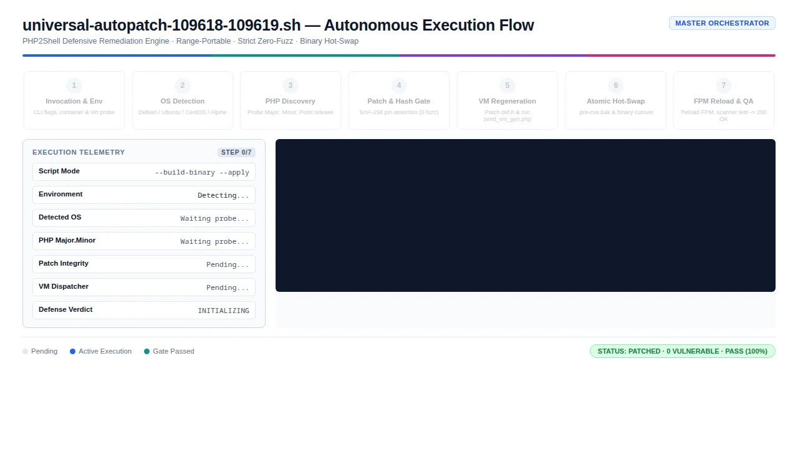
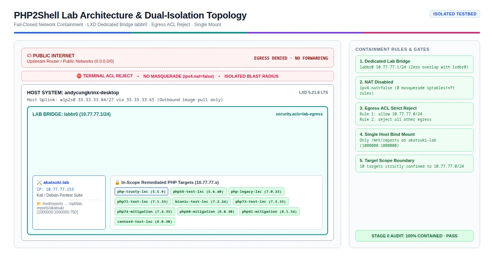
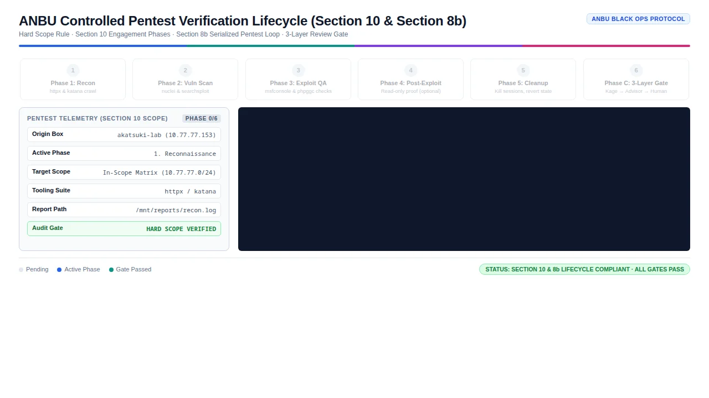

# PHP2Shell Local Lab

A reproducible, network-isolated lab for verifying the **CVE-2026-109618** and
**CVE-2026-109619** PHP patches across every operating system the collection
supports.

The lab builds a matrix of PHP hosts, puts them on a bridge with no route to the
internet, applies the fix, and scans each one from a separate attacker box. Every
claim it makes is backed by a command you can re-run.

---

## Why the lab exists

The patch collection ships source patches for eleven PHP branches. A patch that
applies cleanly is not the same thing as a host that is no longer vulnerable.
Those are two different claims, and only the second one matters to anyone running
a server.

This lab exists to test the second claim. It stands up real hosts running real
PHP, applies the real fix, and then asks a scanner whether the vulnerability is
actually gone.

---

## Quick start

```bash
cd local-lab
./setup.sh preflight     # check the host can run this
./setup.sh provision     # build the lab
./setup.sh scan          # verify every target
```

Full build takes roughly 30–60 minutes, almost all of it downloading images and
compiling PHP. `preflight` alone takes seconds and is worth running first — it
catches the four problems that otherwise waste an hour.

When you are done:

```bash
./setup.sh teardown --yes
```

---

## What gets built

```
        HOST  (andycungkrinx-desktop)
          │
          │  no masquerade for 10.77.77.0/24
          │
    ┌─────┴──────────────────────────────────────────────┐
    │  labbr0   10.77.77.1/24   ipv4.nat=false           │
    │  ACL: allow 10.77.77.0/24 · reject everything else │
    └─────┬──────────────────────────────────────────────┘
          │
          ├── akatsuki-lab        attacker / verification box
          │                       (only bind mount: /mnt/reports)
          │
          └── 9 targets, each running PHP-FPM behind nginx
```

| Target | Base | PHP | Layout |
|---|---|---|---|
| `php-trusty-lxc` | Ubuntu 14.04 | 5.5.9 | `/etc/php5/fpm/conf.d` |
| `php56-test-lxc` | Ubuntu 18.04 | 5.6.40 | `/etc/php/5.6/fpm/conf.d` |
| `php-legacy-lxc` | Ubuntu 16.04 | 7.0.33 | `/etc/php/7.0/fpm/conf.d` |
| `php71-test-lxc` | Ubuntu 18.04 | 7.1.33 | `/etc/php/7.1/fpm/conf.d` |
| `bionic-test-lxc` | Ubuntu 18.04 | 7.2.24 | `/etc/php/7.2/fpm/conf.d` |
| `php73-test-lxc` | Ubuntu 20.04 | 7.3.33 | `/etc/php/7.3/fpm/conf.d` |
| `php74-mitigation` | Ubuntu 20.04 | 7.4.33 | `/etc/php/7.4/fpm/conf.d` |
| `php80-mitigation` | Ubuntu 22.04 | 8.0.30 | `/etc/php/8.0/fpm/conf.d` |
| `php81-mitigation` | Ubuntu 22.04 | 8.1.34 | `/etc/php/8.1/fpm/conf.d` |

Scope is PHP 5.5 through 8.1, one target per branch. Each host serves a binary we
built ourselves from the pristine upstream tarball plus the range patch, so every
row reports PATCHED / NOT VULNERABLE / PASS.

The PHP column is the version of the binary actually serving. On the 5.6, 7.1 and
7.3 hosts that is *not* the host's default `php` — those are clones of the 7.2 and
7.4 hosts that inherit a working toolchain, and they serve our build through a
dedicated FPM pool on a loopback port.

Run `./scripts/70-scan-all.sh` and read the output for the recorded observations.

### Out of scope: RHEL and its rebuilds

RHEL, AlmaLinux, Rocky Linux and Oracle Linux are **deliberately excluded**.
Red Hat ships an official fix for both CVEs through errata:

| Distribution | Errata |
|---|---|
| EL8 `php:7.4` | `ALSA-2026:87080` |
| EL8 `php:8.2` | `ALSA-2026:87073` |
| EL9 `php:8.2` | `ALSA-2026:87072` |
| EL9 `php:8.3` | `ALSA-2026:87079` |

Applying a third-party backport to a platform that already has a vendor fix is
redundant, and on a package-managed host it risks conflicting with the vendor
package. Those hosts belong on the distribution's own update channel.

CentOS Stream 9 and 10 appear above because they are separate distributions from
RHEL, and because they are useful as a **verification control**: they show what
an upstream-maintained PHP looks like under the same scan.

---

## The containment model

Isolation here rests on two mechanisms, and neither is sufficient alone:

1. **`ipv4.nat=false`** — LXD installs no masquerade rule for the lab subnet, so
   nothing is translated onto the host uplink.
2. **A default-deny egress ACL** — even without NAT, a Linux bridge still forwards
   between its subnet and the uplink. The ACL's terminal `reject` is what actually
   stops traffic.

A third detail bites in practice: LXD hoists destination-less ACL rules to the top
of the generated ruleset. Writing the catch-all `reject` first therefore rejects
everything, including traffic between lab hosts. Rules are ordered with the
scoped allow first and the catch-all last for that reason.

Provisioning needs internet, so a **separate temporary bridge** (`labprov0`) is
created for it and deleted afterwards. The alternative — briefly enabling NAT on
the lab bridge — opens a window where containment does not hold, and a script that
dies in that window leaves the lab exposed. `scripts/11-close-provisioning.sh`
verifies the teardown behaviourally: it makes a real outbound connection from
inside a container and requires it to fail, then confirms the host still has
internet so the failure means containment rather than a broken uplink.

---

## Documentation

| Document | Covers |
|---|---|
| [docs/01-prerequisites.md](docs/01-prerequisites.md) | Host requirements and the sudoers drop-in |
| [docs/02-architecture.md](docs/02-architecture.md) | Network design and why it is built this way |
| [docs/03-pentest-flow.md](docs/03-pentest-flow.md) | The full verification process, stage by stage |
| [docs/04-oracle-finding.md](docs/04-oracle-finding.md) | Why a correctly patched host returns HTTP 502 |
| [docs/05-cross-os-matrix.md](docs/05-cross-os-matrix.md) | Which OS is tested where, and by what |
| [docs/images/](docs/images/) | Architecture diagram and animated flow |

<p align="center">
  
</p>
<p align="center"><em>Figure 1: Universal Autopatch Autonomous Execution Flow (<a href="docs/images/autopatch-flow.svg">Vector SVG</a>)</em></p>

<p align="center">
  
</p>
<p align="center"><em>Figure 2: Dual-Isolation Lab Network Topology (<a href="docs/images/lab-topology.svg">Vector SVG</a>)</em></p>

<p align="center">
  
</p>
<p align="center"><em>Figure 3: ANBU Controlled Pentest Verification Lifecycle (Section 10 & Section 8b) (<a href="docs/images/anbu-pentest-flow.svg">Vector SVG</a>)</em></p>

Read `docs/04-oracle-finding.md` before interpreting any 502. It is the single
most misread result this lab produces.

---

## Layout

```
local-lab/
├── setup.sh                 # main entry point
├── lab.conf                 # every tunable value lives here
├── sync-codebase.sh         # mirror the code under test, with drift detection
├── codebase/                # GENERATED mirror — never edit by hand
├── scripts/
│   ├── _common.sh           # shared helpers
│   ├── 00-preflight.sh      # host capability checks
│   ├── 01-isolated-bridge.sh
│   ├── 02-de-nat-legacy-bridge.sh
│   ├── 10-open-provisioning.sh
│   ├── 11-close-provisioning.sh   # containment gate
│   ├── 20-provision-targets.sh
│   ├── 21-fix-nics.sh       # fixes the most common lab failure
│   ├── 30-harden-targets.sh # runtime caps
│   ├── 40-attacker-box.sh
│   ├── 50-snapshot.sh       # rollback points
│   ├── 70-scan-all.sh       # verification sweep
│   └── 90-teardown.sh       # destructive, requires --yes
└── docs/
```

**`codebase/` is generated.** The canonical patches live in
`../cve-2026-109618-109619/`. Run `./sync-codebase.sh` to regenerate and
`./sync-codebase.sh --check` to detect drift. Editing the mirror is how two
versions of the truth appear; the manifest exists to make that visible.

---

## Reading the results

| Result | Means | Action |
|---|---|---|
| `NOT VULNERABLE` / `NO SIGNAL` | The probe was handled normally | None |
| `NOT VULNERABLE` / `FIXED` | No crash and the version is above the fix | None |
| `VULNERABLE` (502) | A worker died during the probe | **Check the FPM log before concluding** |
| `INCONCLUSIVE` (413) | The web server answered before PHP saw it | Set `client_max_body_size 0`; the cap belongs at the PHP layer |

A 502 is ambiguous by nature. The upstream fix terminates the worker rather than
recovering, so a **correctly patched** host can return 502 as well as a vulnerable
one. The discriminator is the FPM log:

```
# patched — worker exited deliberately
child <pid> exited with code 1

# vulnerable — worker crashed
child <pid> exited on signal 11 (SIGSEGV)
```

The first is the fix working. The second is the vulnerability. Detailed in
[docs/04-oracle-finding.md](docs/04-oracle-finding.md).

If a scan returns 413, the web server capped the body before PHP could. The
scanner's probes are 1 MiB, 8 MiB and 20 MiB, so any finite `client_max_body_size`
below 20 MiB breaks the scan. Set it to `0` (unlimited) and let PHP's
`post_max_size` be the layer that discards the body — that way the scanner gets a
real verdict instead of a short-circuit.

---

## Requirements

- Linux host with LXD ≥ 5.0, running as root or in the `lxd` group
- ~40 GiB free disk
- Docker (only for the separate `test-cross-os-e2e.sh` suite)
- Read access to `nft list ruleset` for containment verification (see
  [docs/01-prerequisites.md](docs/01-prerequisites.md))

---

## Scope and safety

This lab targets **only** the containers in `lab.conf`. Nothing else on the host
is touched, and no scan reaches any host outside `10.77.77.0/24`. Anything the
scanner surfaces that is not in the target list is recorded as
`out-of-scope, not tested` — never scanned, never silently skipped.

The verification is **defensive**. It confirms the fix holds. It does not weaponise
the vulnerability, and the tooling here contains no exploit for either CVE.
