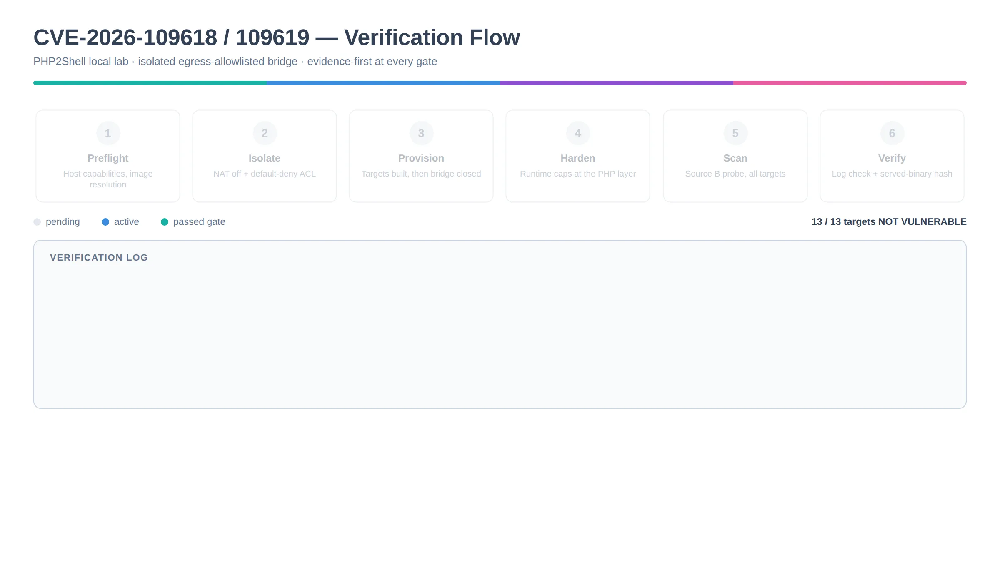

# Verification Flow — Stage by Stage

The complete process the lab runs, in order, with the gate that each stage
enforces and the failure it prevents.



This is a **verification** flow. It confirms the fix holds. It does not weaponise
the vulnerability and contains no exploit for either CVE.

---

## Stage 0 — Containment pre-flight

**Gate: fail-closed.** If any check fails, stop. Do not proceed and do not work
around it.

| Check | Requirement | Why |
|---|---|---|
| Bridge exists | Targets are on a dedicated lab bridge | Nothing else shares the blast radius |
| NAT disabled | `ipv4.nat = false` | No masquerade onto the host uplink |
| Egress denied | Terminal ACL `reject` | A bridge forwards without NAT; the ACL is what stops it |
| Mount isolation | One bind mount only | No host filesystem exposure beyond reports |
| Snapshots present | Every container has one | No rollback point means no safe remediation |

Verified behaviourally, not by reading config: an outbound connection is attempted
from inside a container and must fail, and the host must still have internet so
the failure proves containment rather than a broken uplink.

> A lab that fails Stage 0 produces scan results that look real. They are not.

---

## Stage 1 — Baseline

Establish what each host is **before** anything is changed. Without this there is
nothing to compare against later, and a "pass" cannot be distinguished from "was
never vulnerable".

```
scripts/50-snapshot.sh          # rollback points first
scripts/70-scan-all.sh          # baseline verdict per target
```

Records per target: OS, PHP version, SAPI, FPM conf.d path, scanner verdict.

**Two independent sources:**

| Source | Method | Failure mode |
|---|---|---|
| A — version | Compare against known fixed releases | Misses backports at an unchanged version |
| B — behavioural | Send the probe, observe the response | Cannot distinguish the two causes of a 502 |

They disagree in known ways. Source A misfiles a vendor backport as `UNKNOWN`
because the version string did not change. Source B reports a patched host as
`VULNERABLE` because the fix terminates the worker. Neither error is detectable
from one source alone, which is the entire reason both are run.

**Baseline results** fall into three buckets:

- Already fixed (vendor patch, or version above the fixed release)
- Vulnerable (probe causes a crash)
- Inconclusive (probe never reached PHP)

---

## Stage 2 — Remediation

Only hosts that are vulnerable or inconclusive are touched. Already-fixed hosts
are left alone; changing them destroys the control.

Three paths, chosen by what the host actually is. There is no fourth path, and
improvised fixes are not permitted.

| Path | Applies to | Method |
|---|---|---|
| Cap only | Cannot compile, or no patch exists | Runtime caps at the PHP layer |
| Rebuild | Compiler available, patch exists | Build patched FPM from source, swap the binary |
| Vendor | Vendor ships a fix | Distro update channel — **not this collection** |

### Rules that are not negotiable

**Zero fuzz.** `patch -p1 --fuzz=0`. In a generated opcode dispatch table, fuzzy
context matching can splice a security hook into the wrong opcode case. A patch
that needs fuzz to apply is the wrong patch.

**Version stays put.** The fix is a backport. Upgrading the package changes
behaviour beyond the vulnerability and breaks the deployment being protected.

**Snapshot before touching.** No snapshot, no remediation.

**`Zend/zend_vm_execute.h` is generated, not patched.** Static hunks against it
drift between minors and would require fuzz. The patch touches
`Zend/zend_vm_def.h` instead and the dispatcher is regenerated with the target
version's own `zend_vm_gen.php`. This keeps the whole operation at `--fuzz=0` and
removes 34 of the 90 upstream hunks.

---

## Stage 3 — Hardening

Runtime caps applied at the **PHP layer**, not the web server:

```
max_input_nesting_level = 20
max_input_vars          = 200
max_input_time          = 60
post_max_size           = 900K
session.upload_progress.enabled = Off
```

The probe nests a field name ~62 levels deep and floods part-header lines. These
caps reject the structure before it reaches the vulnerable parser.

**The web server must NOT be the layer that caps this.** The scanner's probes are
1 MiB, 8 MiB and 20 MiB. With any finite `client_max_body_size` below 20 MiB,
nginx answers 413, the probe never completes, and the scanner returns
`INCONCLUSIVE`. That reads as "blocked" when the truth is "never tested". Set
`client_max_body_size 0` (unlimited) so PHP discards the body and returns a real
response.

---

## Stage 4 — Re-verification

Re-run the same scan as Stage 1 and compare.

**A remediation counts as verified only when:**

1. The scanner reported `VULNERABLE` before and not after, **and**
2. the patched binary is confirmed to be the one serving requests (hash match), **and**
3. the PHP version string is unchanged.

Any two of the three is not verification. In particular, a clean scan on a host
where the old binary is still serving proves nothing — confirm the hash.

---

## Stage 5 — Interpretation

| Scanner | Log | Verdict |
|---|---|---|
| NOT VULNERABLE | any | Fixed or mitigated — confirm which |
| VULNERABLE (502) | `exited with code 1` | **Fix working** — controlled termination |
| VULNERABLE (502) | `exited on signal 11` | Still vulnerable |
| VULNERABLE (502) | `core dumped` | Still vulnerable |
| INCONCLUSIVE (413) | — | Web server capped the body; lower its limit below `post_max_size` |
| INCONCLUSIVE (other) | — | Probe never reached PHP; inspect |

Full reasoning in [04-oracle-finding.md](04-oracle-finding.md).

---

## Fail-closed rules

1. Stage 0 failure stops the run. Fix it; do not work around it.
2. A target with no snapshot is not remediated.
3. A patch that fails `--fuzz=0` is not applied with fuzz.
4. Nothing outside the declared target list is scanned. Anything else the scanner
   surfaces is recorded as `out-of-scope, not tested`.
5. If the same remediation fails identically twice on one host, stop retrying it
   and report it. Repeating a failed action is not investigation.
6. Never adjust a fix to produce a pass. A forced pass is worse than a failure,
   because it is a failure that has been hidden.

---

## Sequence & ANBU Pentest Lifecycle

<p align="center">
  
</p>
<p align="center"><em>Figure 2: ANBU Controlled Pentest Verification Lifecycle (<a href="images/anbu-pentest-flow.svg">View Vector SVG</a>)</em></p>

---

## What this flow does not do

- It does not exploit either CVE. There is no payload, no shell, no code execution.
- It does not test any host outside `10.77.77.0/24`.
- It does not modify the host OS. The host is a baseline; all mutation happens
  inside disposable containers.
- It does not claim proof of immunity from a clean scan. `NO SIGNAL` means no
  crash was observed. That is the honest boundary of what a scanner can tell you,
  and the reports say so.
